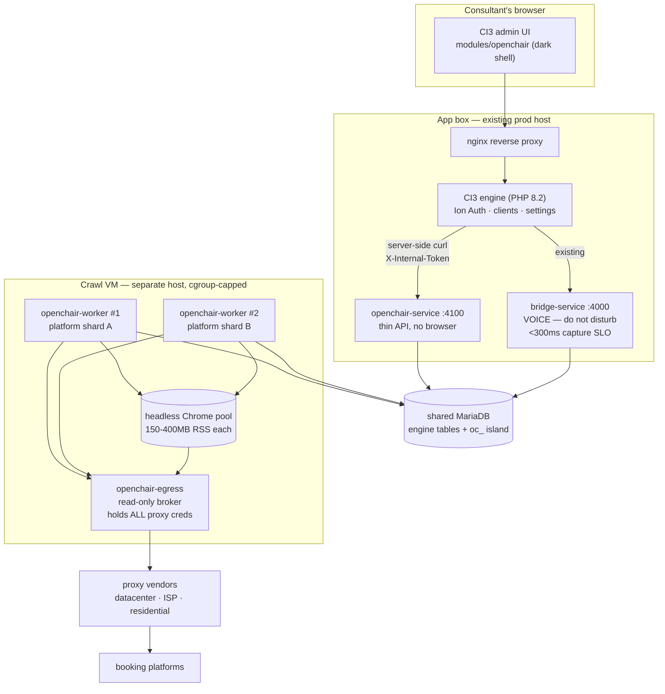
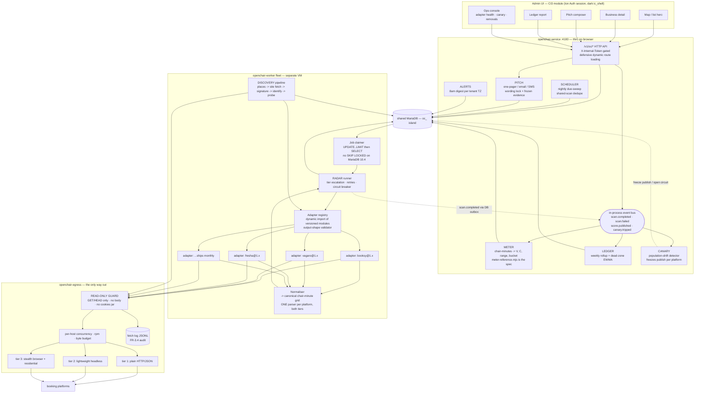
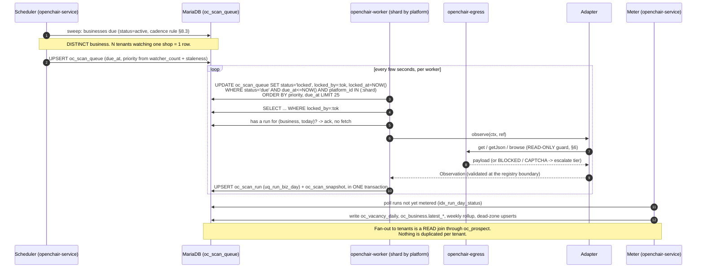

# OpenChair — Technical Architecture

> **Status:** DRAFT v0.1 — architect's recommendation, pre-build.
> **Companions:** [00-brief](00-brief.md) · [05-prd](05-prd.md) · [10-market-and-offer](10-market-and-offer.md) ·
> [30-data-model](30-data-model.md) · [35-scoring-model](35-scoring-model.md) · [45-flows](45-flows.md)
> **Host-repo rules this doc is written against:** [`../../CLAUDE.md`](../../CLAUDE.md),
> [`../../OMlessons.md`](../../OMlessons.md), [`../../engine/CLAUDE.md`](../../engine/CLAUDE.md),
> [`../../engine/bridge-service/CONTRACTS.md`](../../engine/bridge-service/CONTRACTS.md).

## How to read the evidence marks

Every factual claim about the outside world carries a mark:

* **[VERIFIED]** — high confidence from public developer documentation and platform behaviour known to
  the author. **It was not re-checked live in this session.** Anything the spike touches must be
  re-verified against the live site before a line of adapter code is written.
* **[ASSUMPTION]** — my model or my estimate. Argue with it; do not cite it as fact.
* **"not re-verified — confirm before build"** — I believe something is true but will not put a
  specific number, endpoint or vendor behaviour behind it without checking.

Arithmetic derived from my own inputs is marked **[MODEL]**: reproducible from the inputs printed next
to it, and it moves when they move.

---

## 0. The three sentences that decide this build

1. **The crawler must never share a process, an event loop, or a machine's CPU headroom with
   `bridge-service`.** Headless Chrome plus 20 ms Twilio media frames is not a trade-off, it is a
   defect. This single constraint selects the build target (§1).
2. **The adapter is the product.** Everything else in OpenChair is ordinary CRUD over a schema another
   architect has already specified. The only genuinely novel and genuinely fragile thing is reading six
   hostile third-party booking surfaces every night, for about two cents each, forever (§3, §5, §7).
3. **"Never books a slot" must be a property of the interface, not of the code review.** An adapter has
   to be structurally unable to express a booking, because no verb in its API can make one (§6).

---

## 1. Build-target decision

### 1.1 The three options

| | Option | Shape |
|---|---|---|
| **(a)** | New CI3 module + routes inside `bridge-service` | `engine/application/modules/openchair/` for the UI; `/v1/oc/*` routes and the crawl workers inside the existing Node service |
| **(b)** | Standalone sibling Node service on the shared DB | `engine/application/modules/openchair/` for the UI; a **new** Node 22 ESM service `openchair-service` (+ an `openchair-worker` fleet), same house patterns, same MariaDB, server-to-server over `X-Internal-Token` |
| **(c)** | Fully separate product | Own repo, own auth, own DB, own billing |

### 1.2 Recommendation

> ## **Option (b) — a sibling service. It is not close.**
>
> Concretely: **three new processes, one new CI3 module, zero changes to `bridge-service`.**

| Process | Role | Where it runs |
|---|---|---|
| `openchair-service` | HTTP API on `:4100`. Thin. Reads/writes the `oc_*` tables, serves the map / list / detail / pitch / ledger JSON the CI3 module curls, exposes `/health` + `/metrics`. **Never launches a browser.** | App box, alongside bridge-service |
| `openchair-worker` | The Radar crawl fleet. N processes, each owning a shard of platforms. Launches headless Chrome. Claims jobs from `oc_scan_queue`. | **A separate VM.** Not the app box. |
| `openchair-egress` | The read-only HTTP / proxy broker (§6). The only component holding proxy credentials and the only one with outbound network reach. | Co-located with the workers |
| `modules/openchair/` (CI3) | The dark-themed admin UI, Ion Auth session, entitlements, the ops console. Curls `openchair-service` server-side exactly as `Instantclose.php` curls the bridge today. | Existing PHP app |

### 1.3 Why option (a) is disqualified — the SLO argument, properly

NFR-7 says the crawl fleet must not degrade the bridge-service voice-capture SLO (`<300 ms` capture,
and behind it the "seconds to first voice ≈ 3 s" promise). Five independent mechanisms break that if
the crawler lives in-process, and **each one alone is sufficient**.

**1. The event loop is shared and JS is single-threaded.**
`bridge-service` runs the Triple-Trigger state machine, `/v1/capture`, the WS signaling lanes and — the
part that matters — **in-process voice relays** (`src/voice/geminiRelay.js`, `elevenRelay.js`,
`twilioVoice.js` / `mulaw.js`). A Twilio media stream is 8 kHz µ-law in **20 ms frames**
[VERIFIED — Twilio Media Streams frame cadence]. Every frame must be received, transcoded and forwarded
inside that budget. A crawler on the same loop does CDP protocol chatter (every DOM query, every
network event, every response body arrives as a JSON message over a WebSocket and is `JSON.parse`d on
that same loop), HTML parsing and grid normalisation. One 40 ms parse of a 3 MB booking page is two
dropped audio frames. No scheduling trick fixes it: `setImmediate` yielding does not make a 3 MB
`JSON.parse` interruptible.

**2. The libuv threadpool is shared and small.**
Default `UV_THREADPOOL_SIZE` is 4 [VERIFIED — Node.js default]. It serves `fs`, `dns`, `zlib` and
crypto. The crawler wants async gzip on every snapshot (`oc_scan_snapshot.grid_gz`) and does heavy DNS.
Saturating those four threads delays the voice path's own DNS and TLS work. You can raise the pool
size, but raising it on a process also doing realtime audio trades starvation for CPU contention.

**3. GC pressure is shared.**
Page harvesting allocates multi-megabyte strings and buffers at a high rate, driving major GC in the
same V8 heap that holds the audio ring buffers. A stop-the-world pause is invisible in a crawler and
audible in a phone call. [VERIFIED — the mechanism is standard V8 behaviour; the pause length is
[ASSUMPTION], tens of milliseconds at these heap sizes.]

**4. Deploy cadence is incompatible — and this is the argument that actually settles it.**
The commercial plan is **"ship a new adapter monthly as OTO value"** (00-brief), and `oc_platform` is a
table precisely so that a new adapter is a seed row rather than a migration. Adapters are the most
frequently changed and most frequently broken code in the system: a platform ships a layout change and
you hotfix the same day. If adapters live inside `bridge-service`, **every adapter hotfix restarts the
process holding live WebRTC and Twilio media-stream sessions.** You would drop customers' live AI voice
calls to fix a CSS selector on Booksy. No graceful-drain scheme makes a weekly restart cadence
acceptable on a realtime service. The worker fleet, by contrast, is stateless by construction — a
worker restart returns leased jobs to `due` and nothing user-visible happens. **Put the churn where the
restart is free.**

**5. Blast radius and memory.**
Headless Chrome is roughly **150–400 MB RSS per instance** [ASSUMPTION — order of magnitude; depends on
flags and page weight]. Twenty concurrent contexts is 3–8 GB and near-saturation CPU on an 8-vCPU box.
An OOM kill on that process today takes down lead capture, the state machine and every live voice
session. The defensive dynamic-route-loading pattern in `src/server.js` protects against a *broken
module*; it does nothing about a *resource-exhausted process*.

> **The house pattern already agrees with this conclusion.** `src/server.js` loads every route module
> defensively so that "a missing/broken module makes only that surface return 503 while the service
> still boots and `/health` stays green". That is fault isolation at the module level. The crawler
> needs the same principle one level up — at the **process and machine** level — because its failure
> mode is not "throws an exception", it is "eats the box".

**Could you keep (a) and just run Chrome in a child process?** That removes mechanism 3 and softens 5,
but 1 (CDP chatter on the parent loop), 2 (threadpool), 4 (deploy cadence) and the CPU half of 5
remain. And once the browser is already a separate process, the only remaining benefit of (a) is "one
fewer `npm start`" — not a benefit worth a realtime SLO.

### 1.4 Why option (c) is disqualified

A fully separate product throws away everything the host repo already solved and that the data model
already depends on:

| What (c) would have to rebuild | What (b) reuses today |
|---|---|
| Auth, roles, sub-accounts | Ion Auth `users`, `groups`, `users_groups`, `clients`, `client_users` |
| Entitlements / access codes / SKU gating | The engine's existing access-code machinery (migrations through `ic_045`) |
| BYOK credential storage | `settings`, per-user, encrypted, `meta_type` — the data model explicitly forbids an `oc_credentials` table |
| Cost metering | `api_usage_log` |
| Suppression / DNC / consent | `suppression_list`, `phone_blocklist`, `dnc_check_cache` — "OpenChair adds zero compliance tables" |
| Business-removal / DSAR intake | `data_rights_requests` |
| White-label custom domains (OTO2) | `funnels.custom_domain*` + `custom-ssl/cname_ssl_instaclose.sh` + `subdomain_data/` — a working, deployed, cron-driven certbot pipeline |
| Digest plumbing for the 8am list | The engine's existing notification/sequence plumbing |
| The MotionStack handoff | `oc_prospect.client_id → clients.id` and `oc_prospect.funnel_id → funnels.id` — a won prospect becomes a Bridge in one click |

`30-data-model.md` is written as an island inside the shared schema with loose INT links out to
`users`, `clients`, `funnels`. **Option (c) invalidates that document.** It is a decision to redo the
data-model work, not a decision about deployment.

The one honest argument for (c) is corporate: if OpenChair might be spun out or sold separately, a
shared DB is an entanglement. The mitigation is already in the schema — the `oc_` island has **zero
FKs into engine tables**, so extraction later is "copy 17 tables and write an auth shim", not a
rewrite. **Design for (b), keep the (c) exit open, do not pay for it now.**

### 1.5 What option (b) costs, honestly

| Cost | Size | Mitigation |
|---|---|---|
| A second deployable, `.env` and systemd unit | Small, one-off | Copy the bridge-service layout verbatim: same `src/config.js` idiom, same `loadEnvFile`, same defensive route loading, same `/health`, same `deploy/preflight.sh` gate |
| A second VM (~$40/mo [ASSUMPTION]) | Small | It pays for itself the first night the crawler would otherwise have jittered a customer's call |
| Two services on one DB → schema coupling | Medium | Already accepted by the data model. `oc_*` is written by OpenChair only; the engine reads nothing from it |
| Ops surface doubles | Medium | Both expose `/metrics` in the existing Prometheus shape (`src/observability/metrics.js`); one CI3 ops page reads both |
| Shared MariaDB connection budget | **Medium — the real one** | This is the one resource (b) does *not* isolate. Hard-cap the worker connection pool (§8.6) and keep every worker query indexed and short |

### 1.6 Deployment topology



Rules encoded in that picture:

* Nothing in `CRAWLBOX` can reach `BRIDGE`, and nothing in `BRIDGE` imports anything from OpenChair.
* `openchair-service` never launches a browser. If `playwright` is ever imported there, the isolation
  is gone — make it a CI grep (§6.6).
* Workers reach the internet **only** through `openchair-egress`. No direct `fetch`, no `node:http`.
* If the second VM is genuinely unaffordable at launch, the fallback is a systemd cgroup on the app
  box: `CPUQuota=250%`, `MemoryMax=4G`, `Nice=10`, `IOSchedulingClass=idle`, plus a hard cap of 4
  browser contexts. **This is a degraded configuration, not the design**, and it must be load-tested
  against the capture SLO before it is used (§9.5).

### 1.7 Answer to PRD open question Q2

> **Q2 — Build target?** **Sibling service (b).** UI as a CI3 module under the Separation Charter; API
> and crawl fleet as a new Node 22 ESM service built to identical house patterns; crawl workers on
> their own VM. The deciding factor is not performance in the abstract — it is that adapters change
> weekly and `bridge-service` holds live voice sessions that must not be restarted to fix a selector.

---

## 2. Component architecture

### 2.1 The components and who owns what

| Component | Lives in | Responsibility | Writes |
|---|---|---|---|
| **Discovery** | `openchair-worker` (own job class) | niche+city → candidate businesses → booking-platform detection → verified `oc_business` row | `oc_business`, `oc_discovery_candidate` (§4.6) |
| **Scheduler** | `openchair-service` (cron) + DB | Decides which businesses are due tonight and at what priority; enforces shared-scan dedupe | `oc_scan_queue` |
| **Radar** | `openchair-worker` | Claims a job, routes to an adapter, escalates fetch tier, normalises, writes the run + snapshot | `oc_scan_run`, `oc_scan_snapshot`, `oc_staff`, `oc_business_service` |
| **Adapter registry** | `openchair-worker` | Loads versioned adapter modules, validates their output shape, applies kill switches | — (reads `oc_platform`) |
| **Egress broker** | `openchair-egress` | The only network path out. Read-only enforcement, proxy selection, per-host concurrency, byte budget | JSONL fetch log |
| **Meter** | `openchair-service` (event-driven) | Chair-minutes → Vacancy Score, confidence, Empty-Chair range, bucket. Pure computation, per `35-scoring-model` §9 | `oc_vacancy_daily`, `oc_business.latest_*` |
| **Ledger** | `openchair-service` | Weekly rollup + dead-zone accumulator; 8-week trend; white-label report freeze | `oc_vacancy_weekly`, `oc_deadzone_cell`, `oc_ledger_report` |
| **Pitch** | `openchair-service` | One-pager / email / SMS generation with frozen evidence grid; compliance wording lock | `oc_pitch` |
| **Alerts** | `openchair-service` (cron per tenant TZ) | The 8am digest, ranked by delta, split by bucket | `oc_alert_run`, `oc_alert_item` |
| **API** | `openchair-service` | The `/v1/oc/*` surface the CI3 module curls; internal-token gated | — |
| **Admin UI** | `modules/openchair/` (CI3) | Map/list hero, business detail, watchlist, pitch, ledger, ops console | `oc_market`, `oc_prospect` (via API) |

### 2.2 Component diagram



### 2.3 Two notes on the wiring

**The event bus does not span processes.** `bridge-service` has an in-process bus (`src/events.js`) and
`openchair-service` gets the same pattern. But the workers are on another machine, so
`scan.completed` cannot be an in-memory emit. Use a **DB outbox**: the worker writes `oc_scan_run` +
`oc_scan_snapshot` in one transaction and sets `status='ok'`; `openchair-service` polls
`idx_run_day_status` every 5 s for runs not yet metered and emits `scan.completed` locally. This is
simple, crash-safe, needs no broker, and at ~5 runs/sec the poll is trivial. **Do not introduce a
message broker for this.**

**Meter runs in `openchair-service`, not in the worker.** `35-scoring-model.md` §9 says so explicitly,
and it is right: scoring is pure computation that must be re-runnable over history when `model_version`
changes. Keeping it out of the worker means a scoring bug is fixed by a recompute, not a re-crawl —
and a re-crawl is the expensive thing.

---

## 3. The Radar adapter framework

This is the most important design in the document. Everything about cost, reliability, legal posture
and the monthly OTO cadence is decided by the shape of this interface.

### 3.1 Design principles

1. **An adapter is a pure function of a transport.** It gets a read-only context and a business
   reference; it returns an `Observation` or throws an `AdapterError`. It opens no sockets, reads no
   files, imports no DB client, holds no state between calls.
2. **One normaliser, two acquisition paths.** The tier-1 (JSON) and tier-2/3 (browser) paths must feed
   the *same* parse function. This is what keeps adapters cheap to maintain, makes fixtures shared, and
   means tier escalation does not double the surface that can break.
3. **The adapter declares its capability class and the framework enforces it.** A `C5_NEXT_AVAILABLE`
   adapter that emits chair-minutes is rejected at the registry boundary, not discovered later in a
   pitch.
4. **Adapters carry no write verb, no interaction verb, and no page handle.** See §6 — this is the
   read-only guarantee, and it is expressed here, in the interface.
5. **Shipping an adapter is a file plus a seed row.** No migration, no schema change, no restart of
   anything a customer can see.

### 3.2 Capability classes — vocabulary locked to `35-scoring-model.md` §1.3

The framework uses exactly these five identifiers. They are the enum in code, the value on the
`Observation`, and the input to the confidence ceiling.

| Constant | Class | Exposed | Confidence ceiling | Platform families (per `oc_platform` seed) |
|---|---|---|---|---|
| `C1_SLOT_GRID` | slot grid — **per-staff slot grid** | per-staff slot grid | **0.95** | booksy, vagaro, fresha, glossgenius, square_appointments, acuity |
| `C2_CLASS_CAPACITY` | class capacity | class duration, capacity K, spots left S | **0.90** | mindbody, momence |
| `C3_ARRIVAL_WINDOW` | arrival window | 2–4 h windows, crew count | **0.75** | housecall_pro, jobber, servicetitan |
| `C4_RESERVATION` | reservation | which times have availability for one party size | **0.65** | opentable, resy |
| `C5_NEXT_AVAILABLE` | next-available | a single date; **no chair-minutes exist** | **0.40** | zocdoc-style clinics |

The ceiling is not an adapter's choice. It is looked up from the class by the framework and multiplied
into `C` (`35-scoring-model` §2.1). **An adapter cannot raise its own confidence.**

### 3.3 The interface — plain ESM, JSDoc types (house rule API-003: no TypeScript)

```js
// openchair-service/src/radar/adapterContract.js
//
// The contract every Radar adapter is built against. Plain ESM + JSDoc — there is
// no TypeScript in this repo and there will not be one (OMlessons API-003).
// This file exports ONLY types, constants and validators. It imports nothing.

/**
 * The five capability classes of 35-scoring-model.md §1.3. Vocabulary is locked:
 * these strings appear in oc_scan_run, in the Meter, and on the pitch artifact.
 * @typedef {'C1_SLOT_GRID'|'C2_CLASS_CAPACITY'|'C3_ARRIVAL_WINDOW'
 *           |'C4_RESERVATION'|'C5_NEXT_AVAILABLE'} CapabilityClass
 */

/** Confidence ceilings, per 35-scoring-model §1.3. Adapters may not override. */
export const CAPABILITY_CEILING = Object.freeze({
  C1_SLOT_GRID:      0.95,
  C2_CLASS_CAPACITY: 0.90,
  C3_ARRIVAL_WINDOW: 0.75,
  C4_RESERVATION:    0.65,
  C5_NEXT_AVAILABLE: 0.40,
});

/**
 * A stable reference to one business on one platform. Built by Discovery,
 * stored as (oc_business.platform_id, oc_business.platform_business_key).
 * @typedef {Object} BookingRef
 * @property {string} platformKey          'booksy'
 * @property {string} platformBusinessKey  the platform's own listing id — the global identity
 * @property {string} bookingUrl           the public "Book now" page. READ ONLY, ALWAYS.
 * @property {string} timezone             IANA. ALL day/hour maths happens in this zone.
 * @property {string[]} [unitHints]        unit ids seen on the previous good scan
 */

/**
 * One servable unit on one day. This is the ONLY numeric shape the Meter accepts;
 * it is 35-scoring-model §1.2 verbatim.
 * @typedef {Object} UnitDay
 * @property {string} unitId       stable across scans: chair, seat-block, crew, table-turn
 * @property {number} dayOffset    1..horizonDays. Day 0 is EXCLUDED (§1.2) — half-consumed.
 * @property {number} envelopeMin  published bookable minutes for that unit that day
 * @property {number} openMin      bookable minutes still open
 * @property {string} [openBits]   optional per-slot bitstring, '1' = open, for the snapshot blob
 */

/**
 * What an adapter returns. Anything not in this shape is a LAYOUT_CHANGED error.
 * @typedef {Object} Observation
 * @property {CapabilityClass} capability
 * @property {string}  timezone
 * @property {string}  day0            ISO date, business-local, of dayOffset 0
 * @property {number}  slotMinutes     modal slot pitch actually observed
 * @property {number}  horizonDays     how far ahead the platform publishes
 * @property {number}  horizonDaysParsed  how far we actually parsed -> horizonCoverage
 * @property {UnitDay[]} units         MUST be empty for C5, non-empty otherwise
 * @property {{unitId:string,label:string|null,displayName:string|null}[]} unitMeta
 * @property {{name:string,priceCents:number|null,durationMin:number|null}[]} services
 * @property {number|null} daysToNext  lead time in days. REQUIRED for C5.
 * @property {number}  coverage        0..1, weight-weighted fraction of expected-open days parsed
 * @property {string[]} flags          subset of the 35-scoring-model §2.1 anomaly vocabulary
 * @property {{requests:number,bytes:number,tier:1|2|3,ms:number}} usage  -> cost_micros
 * @property {*} raw                   normalised grid doc, gzipped into oc_scan_snapshot.grid_gz
 */

/**
 * The read-only transport an adapter is handed. Note what is ABSENT:
 * no post/put/patch/delete, no page handle, no click/type/fill, no cookie jar,
 * no fs, no db. An adapter cannot express a booking because no verb exists for it.
 * @typedef {Object} ReadCtx
 * @property {(url:string, opts?:{headers?:Object,tier?:1|2|3}) => Promise<{status:number,headers:Object,text:string,bytes:number}>} get
 * @property {(url:string, opts?:{headers?:Object,tier?:1|2|3}) => Promise<any>} getJson
 * @property {(recipe:BrowseRecipe) => Promise<BrowseResult>} browse
 * @property {(key:string) => Promise<any>} cacheGet
 * @property {(key:string, value:any, ttlSec:number) => Promise<void>} cacheSet
 * @property {AbortSignal} signal
 * @property {() => number} now
 * @property {{debug:Function,info:Function,warn:Function}} log
 * @property {{bytesLeft:number, msLeft:number, requestsLeft:number}} budget
 */

/**
 * A DECLARATIVE browse request. The adapter describes what it wants harvested;
 * it never receives a Page. There is deliberately no `click`, `type`, `submit`
 * or `evaluate` field — see §6.
 * @typedef {Object} BrowseRecipe
 * @property {string} url
 * @property {{selector?:string, responseUrlPattern?:string, networkIdleMs?:number}} [waitFor]
 * @property {string[]} [capture]     regex sources; matching XHR/fetch responses are returned
 * @property {string[]} [blockTypes]  default ['image','font','media','stylesheet','other']
 * @property {number}  [maxMs]        hard ceiling, default 30000
 * @property {boolean} [screenshot]   grid screenshot for the pitch one-pager
 */

/**
 * @typedef {Object} BrowseResult
 * @property {number} status
 * @property {string} html
 * @property {{url:string,status:number,json:any|null,text:string|null}[]} captured
 * @property {Buffer|null} screenshotPng
 * @property {number} bytes
 * @property {1|2|3} tier
 */

/**
 * Every adapter module exports exactly these four things and nothing else.
 *
 * export const meta      : AdapterMeta
 * export function identify(url, page) : BookingRef|null      // pure, no network
 * export async function probe(ctx, ref)   : CapabilityProbe  // once at discovery
 * export async function observe(ctx, ref) : Observation      // once per night
 */

/**
 * @typedef {Object} AdapterMeta
 * @property {string} key               matches oc_platform.platform_key AND the filename
 * @property {string} version           semver, stamped onto oc_scan_run.adapter_version
 * @property {CapabilityClass} capability
 * @property {number} horizonDays
 * @property {number} slotMinutes
 * @property {{prices:boolean, nextAvailable:boolean, staff:boolean, capacity:boolean}} emits
 * @property {1|2|3} preferredTier      where escalation starts
 * @property {{rpm:number, maxConcurrentPerHost:number, minScanIntervalHours:number}} politeness
 * @property {string[]} hosts           the ONLY hosts this adapter may touch (allow-list)
 * @property {string[]} fixtures        recorded payloads that must still parse in CI
 */
export const ADAPTER_EXPORTS = Object.freeze(['meta', 'identify', 'probe', 'observe']);
```

### 3.4 Error taxonomy

Errors are a first-class part of the contract because the runner's behaviour — retry, escalate tier,
open a circuit, mark the business unreachable — is derived from the code, never from string matching.

```js
// openchair-service/src/radar/AdapterError.js
export class AdapterError extends Error {
  /**
   * @param {keyof typeof ERRORS} code
   * @param {string} message
   * @param {{cause?:Error, detail?:Object}} [opts]
   */
  constructor(code, message, opts = {}) {
    super(message, { cause: opts.cause });
    const spec = ERRORS[code];
    if (!spec) throw new TypeError(`unknown AdapterError code: ${code}`);
    this.name = 'AdapterError';
    this.code = code;
    this.runStatus = spec.runStatus;   // -> oc_scan_run.status (the DDL enum)
    this.retryable = spec.retryable;
    this.escalate  = spec.escalate;    // try the next fetch tier?
    this.circuit   = spec.circuit;     // weight added to the platform circuit breaker
    this.detail    = opts.detail ?? null;
  }
}

/** runStatus values are exactly oc_scan_run.status: ok|partial|blocked|captcha|not_found|timeout|error */
export const ERRORS = Object.freeze({
  NOT_FOUND:       { runStatus:'not_found', retryable:false, escalate:false, circuit:0 },
  GONE:            { runStatus:'not_found', retryable:false, escalate:false, circuit:0 },
  LAYOUT_CHANGED:  { runStatus:'error',     retryable:false, escalate:false, circuit:3 },
  BLOCKED:         { runStatus:'blocked',   retryable:true,  escalate:true,  circuit:2 },
  CAPTCHA:         { runStatus:'captcha',   retryable:true,  escalate:true,  circuit:2 },
  RATE_LIMITED:    { runStatus:'blocked',   retryable:true,  escalate:false, circuit:1 },
  TIMEOUT:         { runStatus:'timeout',   retryable:true,  escalate:true,  circuit:1 },
  TRANSPORT:       { runStatus:'error',     retryable:true,  escalate:false, circuit:1 },
  PARTIAL:         { runStatus:'partial',   retryable:false, escalate:false, circuit:0 },
  BUDGET_EXCEEDED: { runStatus:'error',     retryable:false, escalate:false, circuit:0 },
  UNSUPPORTED:     { runStatus:'error',     retryable:false, escalate:false, circuit:0 },
  POLICY_REFUSED:  { runStatus:'error',     retryable:false, escalate:false, circuit:0 },
});
```

Two codes deserve comment:

* **`LAYOUT_CHANGED` is not retryable and carries the heaviest circuit weight.** It means the page
  parsed but produced a shape the validator rejected. Retrying wastes money; three of them in an hour
  should open the platform circuit and page an operator. This is the *cheap* half of the canary — the
  expensive half (plausible-but-wrong data) is §9.2.
* **`PARTIAL` is a success with a hole.** The run is stored, `coverage < 1`, and the Meter's
  `horizonCoverage` factor takes the confidence hit automatically. It must not be retried and must not
  be treated as a failure in adapter-health metrics, or every platform with a shorter release window
  will look broken.

### 3.5 Freshness, TTL and caching

| Layer | Key | TTL | Why |
|---|---|---|---|
| Availability observation | `business_id` | **24 h floor**, from `oc_platform.min_scan_interval_hours` | FR-3.1 + `UNIQUE(business_id, observed_on)`. Enforced by the DB, not by hope. |
| Discovery / platform identity | `business_id` | **90 days** | Which platform a shop uses "rarely changes" (45-flows §2) |
| `not_bookable` verdict | candidate hash | **90 days** | 45-flows: "never re-scanned for 90d" |
| Menu / service prices | `business_id` | **7 days** | Prices move slowly; skipping the menu fetch on 6 of 7 nights is a real byte saving |
| Adapter JSON contract discovery (§3.7) | `platformKey` | **6 h** | The endpoint shape is per-platform, not per-business — discover once, replay for everyone |
| Unchanged-grid short-circuit | `grid_sha1` | per scan | If the new grid hashes identical to yesterday's, skip the snapshot write; still write `oc_vacancy_daily` |
| Robots / policy cache | host | **24 h** | One fetch per host per day, not per business |

**Freshness is a product-visible quantity, not an internal one.** `35-scoring-model` §2.1 makes scan
age a multiplicative confidence factor (24 h → 1.00, 48 h → 0.90, 72 h → 0.75, 168 h → 0.40, 336 h →
0.00) and §2.3 hard-refuses past 14 days. The architecture's job is to make sure the age is always
truthfully recorded (`oc_scan_run.observed_on`, `oc_business.last_good_scan_at`) so the UI never has to
guess.

### 3.6 Output validation at the registry boundary

Every `Observation` passes a validator before it can touch the DB. This is the single highest-value
50 lines in the codebase: it converts "adapter silently returns garbage" (PRD risk R5, *Critical*) into
`LAYOUT_CHANGED`.

```js
// openchair-service/src/radar/validateObservation.js
import { CAPABILITY_CEILING } from './adapterContract.js';
import { AdapterError } from './AdapterError.js';

const ANOMALY_FLAGS = new Set([
  'suspect_total_blackout','suspect_walk_in','captcha_degraded','multi_location',
  'release_limited','dst_unresolved','slot_pitch_changed','ghost_staff_present',
]);

/**
 * Fails CLOSED. An adapter that returns the wrong shape produces no data at all,
 * rather than plausible-but-wrong data that reaches a business owner's ears.
 * @param {import('./adapterContract.js').Observation} obs
 * @param {import('./adapterContract.js').AdapterMeta} meta
 */
export function validateObservation(obs, meta) {
  const bad = (m, detail) => { throw new AdapterError('LAYOUT_CHANGED', m, { detail }); };

  if (!obs || typeof obs !== 'object') bad('observation is not an object');
  if (obs.capability !== meta.capability) bad('capability drifted from meta', { got: obs.capability });
  if (!(obs.capability in CAPABILITY_CEILING)) bad('unknown capability class');
  if (!Array.isArray(obs.units)) bad('units is not an array');

  // C5 has NO chair-minutes and MUST NOT invent them (35-scoring §1.7).
  if (obs.capability === 'C5_NEXT_AVAILABLE') {
    if (obs.units.length) bad('C5 adapter emitted chair-minutes');
    if (!Number.isInteger(obs.daysToNext)) bad('C5 adapter emitted no lead time');
  } else if (!obs.units.length) {
    bad('non-C5 adapter emitted zero units');   // "everything is booked" must never be a parse failure
  }

  for (const u of obs.units) {
    if (!u.unitId) bad('unit without a stable id');
    if (!Number.isInteger(u.dayOffset) || u.dayOffset < 1 || u.dayOffset > meta.horizonDays) {
      bad('dayOffset out of range — day 0 is excluded by 35-scoring §1.2', { unit: u });
    }
    if (!(u.envelopeMin >= 0) || !(u.openMin >= 0)) bad('negative minutes', { unit: u });
    if (u.openMin > u.envelopeMin) bad('openMin exceeds envelopeMin', { unit: u });
    if (u.envelopeMin > 24 * 60) bad('envelope longer than a day', { unit: u });
  }

  if (!(obs.coverage >= 0 && obs.coverage <= 1)) bad('coverage out of [0,1]');
  for (const f of obs.flags ?? []) if (!ANOMALY_FLAGS.has(f)) bad(`unknown anomaly flag ${f}`);
  if (obs.raw && JSON.stringify(obs.raw).length > 2_000_000) bad('raw grid unreasonably large');
  return obs;
}
```

Note the rule `non-C5 adapter emitted zero units → LAYOUT_CHANGED`. This is deliberate and it is the
difference between a good night and a launch-ending one: **"I found nothing" is never allowed to look
like "everything is booked solid".** A genuinely fully-booked shop still has units with
`envelopeMin > 0, openMin = 0`.

### 3.7 Worked pseudo-implementation A — a slot-grid (C1) platform

Shape modelled on the Booksy/Fresha family: a JS single-page booking widget whose availability comes
from a JSON XHR. **The pattern to copy is "browser discovers the contract, HTTP replays it".**

```js
// adapters/booksy/index.js     (illustrative pseudo-implementation, not production code)
import { AdapterError } from '../../src/radar/AdapterError.js';

export const meta = {
  key: 'booksy',
  version: '1.0.0',
  capability: 'C1_SLOT_GRID',
  horizonDays: 14,
  slotMinutes: 30,
  emits: { prices: true, nextAvailable: true, staff: true, capacity: false },
  preferredTier: 1,
  politeness: { rpm: 12, maxConcurrentPerHost: 2, minScanIntervalHours: 24 },
  hosts: ['booksy.com', 'us.booksy.com'],          // egress allow-list for THIS adapter
  fixtures: ['fixtures/booksy/2026-09-01-3chair.json',
             'fixtures/booksy/2026-09-01-fullybooked.json',
             'fixtures/booksy/2026-09-01-closed-monday.json'],
};

/** Pure, no network. Discovery calls this on every URL it finds on a candidate's site. */
export function identify(url) {
  const m = /^https?:\/\/(?:[a-z]+\.)?booksy\.com\/[a-z-]{2,7}\/[^/]+\/(\d+)[_-]/i.exec(url);
  return m ? { platformKey: 'booksy', platformBusinessKey: m[1], bookingUrl: url } : null;
}

/** Runs ONCE at discovery. Establishes staff count, slot pitch, real horizon. */
export async function probe(ctx, ref) {
  const doc = await loadDocument(ctx, ref);            // same acquisition ladder as observe()
  const units = doc.staffers.filter(s => s.bookable);
  if (!units.length) throw new AdapterError('UNSUPPORTED', 'listing has no bookable staff');
  return {
    capability: meta.capability,
    horizonDays: Math.min(meta.horizonDays, doc.maxBookAheadDays ?? meta.horizonDays),
    slotMinutes: modal(doc.services.map(s => s.durationMin)) || meta.slotMinutes,
    unitCount: units.length,
    flags: doc.maxBookAheadDays < 7 ? ['release_limited'] : [],
  };
}

export async function observe(ctx, ref) {
  const doc = await loadDocument(ctx, ref);
  return normalise(doc, ref);                          // ONE normaliser, whatever tier fetched it
}

/* ── acquisition ladder ─────────────────────────────────────────────────────────
   Tier 1: replay the JSON contract we already know (cheap: ~40 KB, no browser).
   Tier 2/3: render the page and CAPTURE the same XHR, then re-cache the contract.
   Both paths hand the SAME document to the SAME normaliser. That is the whole trick:
   escalation costs money, it does not cost a second parser.                      */
async function loadDocument(ctx, ref) {
  const contract = await ctx.cacheGet('booksy:contract');   // 6h TTL, per-platform not per-business
  if (contract) {
    try {
      const url = contract.availabilityUrl
        .replace('{id}', ref.platformBusinessKey)
        .replace('{days}', String(meta.horizonDays));
      return shapeCheck(await ctx.getJson(url, { tier: 1, headers: contract.headers }));
    } catch (err) {
      if (err.code === 'NOT_FOUND') throw err;               // a dead listing is dead at any tier
      ctx.log.info('booksy: tier-1 replay failed, rendering', { code: err.code });
    }
  }

  const res = await ctx.browse({
    url: ref.bookingUrl,
    waitFor: { responseUrlPattern: 'availability|time_slots' },
    capture: ['availability', 'time_slots', 'staffers', 'services'],
    blockTypes: ['image', 'font', 'media', 'stylesheet', 'other'],   // ~70% of bytes [ASSUMPTION]
    maxMs: 30_000,
  });
  if (res.status === 404) throw new AdapterError('NOT_FOUND', 'listing 404');
  if (looksLikeChallenge(res.html)) throw new AdapterError('CAPTCHA', 'bot challenge served');

  const hit = res.captured.find(c => /availability|time_slots/.test(c.url) && c.json);
  if (!hit) throw new AdapterError('LAYOUT_CHANGED', 'no availability XHR captured');

  await ctx.cacheSet('booksy:contract', {
    availabilityUrl: templatise(hit.url, ref.platformBusinessKey),
    headers: { accept: 'application/json' },
  }, 6 * 3600);

  return shapeCheck(hit.json);
}

/* ── normalisation to chair-minutes (35-scoring §1.2) ───────────────────────── */
function normalise(doc, ref) {
  const units = [];
  const dayCount = new Set();
  for (const staffer of doc.staffers) {
    if (!staffer.bookable) continue;
    for (const day of doc.days) {
      if (day.offset < 1) continue;                    // day 0 excluded — half-consumed at scan time
      const slots = day.slotsByStaffer[staffer.id] ?? [];
      if (!slots.length && !day.published) continue;   // unpublished day ≠ closed day ≠ full day
      const pitch = doc.slotMinutes ?? meta.slotMinutes;
      const openSlots = slots.filter(s => s.available).length;
      units.push({
        unitId: `st:${staffer.id}`,
        dayOffset: day.offset,
        // envelopeMin here is the OFFERED span for the day; the p90 trailing envelope of
        // 35-scoring §1.4 is computed by the Meter across 6 weeks — NOT by the adapter.
        envelopeMin: slots.length * pitch,
        openMin: openSlots * pitch,
        openBits: slots.map(s => (s.available ? '1' : '0')).join(''),
      });
      dayCount.add(day.offset);
    }
  }
  const flags = [];
  if (doc.locations?.length > 1) flags.push('multi_location');
  if (doc.maxBookAheadDays < 7) flags.push('release_limited');

  return {
    capability: 'C1_SLOT_GRID',
    timezone: doc.timezone ?? ref.timezone,
    day0: doc.day0,
    slotMinutes: doc.slotMinutes ?? meta.slotMinutes,
    horizonDays: meta.horizonDays,
    horizonDaysParsed: dayCount.size,
    units,
    unitMeta: doc.staffers.filter(s => s.bookable).map(s => ({
      unitId: `st:${s.id}`,
      label: s.chairLabel ?? null,        // PII-free, safe to render
      displayName: s.name ?? null,        // PERSONAL DATA — purged on its own clock (30-data-model §9)
    })),
    services: (doc.services ?? []).map(s => ({
      name: s.name, priceCents: toCents(s.price), durationMin: s.durationMin,
    })),
    daysToNext: firstOpenDayOffset(units),
    coverage: dayCount.size / meta.horizonDays,
    flags,
    usage: { requests: 1, bytes: 0, tier: 0, ms: 0 },   // filled in by the egress broker
    raw: doc,
  };
}
```

### 3.8 Worked pseudo-implementation B — a next-available-only (C5) platform

The contrast is the point: this adapter emits **no chair-minutes at all**, and the framework enforces
that it cannot.

```js
// adapters/nextavail_clinic/index.js   (illustrative — Zocdoc-style clinic listing)
import { AdapterError } from '../../src/radar/AdapterError.js';

export const meta = {
  key: 'nextavail_clinic',
  version: '0.9.0',
  capability: 'C5_NEXT_AVAILABLE',
  horizonDays: 60,                                  // a lead time, not a grid
  slotMinutes: 0,
  emits: { prices: false, nextAvailable: true, staff: false, capacity: false },
  preferredTier: 2,
  politeness: { rpm: 6, maxConcurrentPerHost: 1, minScanIntervalHours: 24 },
  hosts: ['example-clinic-directory.tld'],          // real host list: confirm before build
  fixtures: ['fixtures/nextavail/soonest.json', 'fixtures/nextavail/none-in-60d.json'],
};

export function identify(url) { /* directory-slug regex — confirm before build */ return null; }

export async function probe(ctx, ref) {
  const obs = await observe(ctx, ref);
  return { capability: meta.capability, horizonDays: meta.horizonDays,
           slotMinutes: 0, unitCount: 0, flags: obs.flags };
}

export async function observe(ctx, ref) {
  const res = await ctx.browse({
    url: ref.bookingUrl,
    waitFor: { responseUrlPattern: 'availability|next-available' },
    capture: ['availability', 'next-available'],
    maxMs: 25_000,
  });
  if (res.status === 404) throw new AdapterError('NOT_FOUND', 'provider listing gone');
  if (looksLikeChallenge(res.html)) throw new AdapterError('CAPTCHA', 'challenge served');

  const hit = res.captured.find(c => c.json);
  if (!hit) throw new AdapterError('LAYOUT_CHANGED', 'no availability payload');

  const dates = (hit.json.availableDates ?? []).map(Date.parse).filter(Number.isFinite).sort();
  const flags = [];
  let daysToNext;
  if (!dates.length) {
    // "Nothing inside the published window" is DATA, not a failure — and it is exactly the
    // Slammed signal. It is clamped at the window edge and flagged so the copy can say
    // "no online availability in the next 60 days", never a fabricated date.
    daysToNext = meta.horizonDays;
    flags.push('release_limited');
  } else {
    daysToNext = Math.max(0, Math.round((dates[0] - startOfLocalDay(ref.timezone)) / 86_400_000));
  }

  return {
    capability: 'C5_NEXT_AVAILABLE',
    timezone: ref.timezone,
    day0: isoLocalDate(ref.timezone),
    slotMinutes: 0,
    horizonDays: meta.horizonDays,
    horizonDaysParsed: meta.horizonDays,
    units: [],                 // MANDATORY empty — validateObservation rejects anything else
    unitMeta: [],
    services: [],
    daysToNext,
    coverage: 1,
    flags,
    usage: { requests: 1, bytes: res.bytes, tier: res.tier, ms: 0 },
    raw: hit.json,
  };
}
```

Downstream, `35-scoring-model` §1.7 takes over: C5 is capped at confidence 0.40 → display band **low**
→ **bucket and lead time only, no Vacancy Score to two significant figures, and no dollars.** The
architecture's contribution is that this is not a convention someone must remember — a C5 adapter
physically cannot produce the inputs that would let the Meter compute dollars.

### 3.9 How a new adapter ships monthly without redeploy risk

Five properties make an adapter drop a low-risk, high-perceived-value event:

1. **A new adapter is a directory plus a seed row.** `adapters/<key>/index.js` + an
   `INSERT … ON DUPLICATE KEY UPDATE` into `oc_platform`. **No schema migration** — the data model made
   `oc_platform` a table for exactly this reason.
2. **The registry loads adapters by dynamic `import()` inside a try/catch**, mirroring the
   `load*Handler()` pattern in `bridge-service/src/server.js` (OMlessons API-002). A broken adapter
   module disables that one platform and logs; the fleet still boots and every other platform still
   scans. This is the difference between "Vagaro is down tonight" and "Radar is down tonight".
3. **Adapters restart nothing customer-visible.** Rolling worker restart, leases return to `due`,
   nobody notices. Contrast with option (a), where the same drop restarts live voice sessions.
4. **Shadow rollout is the default, not an option.** A new adapter starts at
   `oc_platform.rollout='shadow'` (a new column — see §3.10): it is scanned and its runs are written,
   but the Meter does **not** publish `oc_vacancy_daily` rows from it. Promotion to `live` requires:
   * all fixtures still parse in CI (`node --test`), **and**
   * ≥100 real businesses scanned with success rate ≥ 85 %, **and**
   * the canary's population statistics (mean vacancy, null rate, unit-count distribution) inside
     tolerance versus the same niche on already-live platforms, **and**
   * 10 hand-verified businesses with the bucket correct on 10/10.
5. **A kill switch that takes effect in 60 seconds.** `oc_platform.enabled = 0`, re-read by every
   worker on a 60 s timer. This mirrors the house pattern for dynamic allow-lists
   (`src/security/origin.js` refreshes from the DB on a timer so the gate stays synchronous —
   OMlessons API-004). Flip it from the ops console; no deploy, no restart.

**Entitlement, not code, decides who sees a new adapter.** `oc_platform.tier` (`fe|oto1|backend`)
already exists. A monthly "new adapter" OTO drop is therefore a seed row plus a tier value — which
also means the vendor can *promote* an existing adapter into the FE later without touching code.

### 3.10 Small schema additions this design needs

Three gaps between this architecture and `oc_001…oc_006`, all small, all additive. Each must use the
`ic_005` stored-procedure add-column idiom verbatim (`DROP PROCEDURE IF EXISTS` on both sides), per
`30-data-model.md` §8.

| Migration | Change | Why |
|---|---|---|
| `oc_007_discovery.sql` | New table `oc_discovery_candidate` (candidate identity hash, source, name/address/phone/website, `verdict` enum `pending|verified|not_bookable|needs_review`, `confidence` tinyint, `recheck_after` date, `city_key`, `niche_key`) | 45-flows §2 parks `not_bookable` candidates for 90 days, but `oc_business` **cannot hold them** — `platform_id` is `NOT NULL` with a `RESTRICT` FK and `platform_business_key` is part of the unique identity. A non-bookable candidate has neither. Today that flow has nowhere to live. |
| `oc_007` (same file) | `ALTER oc_platform ADD rollout enum('shadow','live','paused','research') NOT NULL DEFAULT 'shadow'` | §3.9 shadow rollout, and the honest home for platforms we have decided not to touch yet (§5.6, §11) |
| `oc_007` (same file) | `ALTER oc_scan_run ADD tier tinyint, ADD bytes int` | §7's cost model is unfalsifiable without per-run tier and byte counts; `cost_micros` alone cannot tell you *why* a night got expensive |

**Deliberately NOT a table: the per-fetch audit log.** FR-3.4 requires every fetch to be audit-logged.
At 100 k businesses × ~8 requests that is ~800 k rows a night, which would out-write every other table
in the schema combined. Write it as **rotated JSONL on the crawl VM** (`ts, run_id, business_id,
platform, method, host, path_hash, tier, proxy_pool, status, bytes, ms`), 30-day retention, with the
per-run aggregates (`requests`, `bytes`, `tier`, `cost_micros`) landing on `oc_scan_run`. The audit
requirement is satisfied; the DB is not punished for it.

---

## 4. Discovery pipeline

Discovery answers "does this business even have online booking, and on what?". It is a **separate,
cheaper, slower, globally-cached** pipeline that runs ahead of Radar (45-flows §2).

### 4.1 Stages

```mermaid
flowchart LR
    S1["Seed: niche + city<br/>(oc_market, deduped globally)"] --> S2["Places/Maps source<br/>name · address · website · phone · geo"]
    S2 --> S2b{"Already a<br/>candidate?"}
    S2b -- yes --> CACHE["reuse verdict<br/>(90d TTL)"]
    S2b -- no --> S3{"Website<br/>present?"}
    S3 -- no --> X1["verdict: not_bookable<br/>recheck_after +90d"]
    S3 -- yes --> S4["Fetch homepage (tier 1)<br/>+ /book /booking /appointments /schedule"]
    S4 --> S5["Signature match on<br/>links · iframes · scripts · JSON-LD"]
    S5 --> S6{"Signature<br/>hit?"}
    S6 -- no --> S7["Tier-2 render:<br/>widget / lazy iframe / JS-injected button"]
    S7 --> S8{"Hit?"}
    S8 -- no --> X1
    S6 -- yes --> S9["adapter.identify(url)<br/>-> platformBusinessKey"]
    S8 -- yes --> S9
    S9 --> S10["adapter.probe(ctx, ref)<br/>capability · units · horizon · slot pitch"]
    S10 --> S11{"Confidence<br/>>= 0.75?"}
    S11 -- no --> REVIEW["verdict: needs_review<br/>NOT shown to tenants"]
    S11 -- yes --> S12["oc_business (verified)<br/>+ oc_scan_queue row"]
    S12 --> S13["enqueue for nightly Radar"]
```



### 4.2 The Places/Maps source

Discovery needs a business enumerator for "barbershops in Tampa". Options, honestly:

| Source | Cost | Terms posture | Verdict |
|---|---|---|---|
| Google Places API (Nearby Search + Place Details) | Meaningful per-call pricing; **exact current rates not re-verified — confirm before build**. Order of magnitude: tens of dollars per 1,000 businesses fully detailed [ASSUMPTION] | Licensed, but caching of most fields is restricted — **re-verify the current Places terms before shipping any cached copy** | **Recommended for launch.** Licensed, complete, and the cost is *one-time and globally shared* |
| OpenStreetMap / Overpass | Free | Open licence, attribution required [VERIFIED] | Good **supplement**; US small-business coverage of hairdressers/barbers is real but patchy [ASSUMPTION] |
| Scraping a maps product directly | "Free" | Squarely against terms | **No.** It is the one place in this build where the legal risk is gratuitous — the licensed API costs cents and the whole product's defence is "we only read public pages politely" |
| Booking-platform directories (e.g. a platform's own city listing pages) | Crawl cost only | Same posture as the availability read itself | **Yes, as a second source** — and it is strictly better data, because a business found there is *definitionally* bookable, skipping stages S3–S8 entirely |

**The strong recommendation is a hybrid**: Places for coverage and address/phone truth, plus
platform-directory sweeps for precision. The directory sweep is what makes coverage feel dense in the
demo, because it never produces a `not_bookable`.

### 4.3 Signature detection

Cheap, deterministic, and where 90 % of the routing happens. Applied to the homepage HTML plus up to
four conventional booking paths, at tier 1:

| Signal | Weight [ASSUMPTION] | Example |
|---|---|---|
| Outbound link whose host+path matches an adapter's `identify()` regex | **0.50** | a `booksy.com/…/12345_…` link in the nav |
| Booking-platform script/widget tag | 0.35 | a platform's embed script `src` |
| iframe whose `src` host is a known booking host | 0.35 | an embedded scheduler |
| JSON-LD `potentialAction` / `ReservationAction` with a booking URL | 0.30 | schema.org markup |
| A "Book"/"Schedule" anchor that redirects (HEAD, no body) to a known host | 0.30 | vanity domain → platform |
| Platform-directory listing matched on name + address | 0.45 | found from the other direction |

Two hard rules:

* **`identify()` returning a `platformBusinessKey` is necessary, never sufficient.** A link proves the
  site *mentions* the platform; it does not prove the key belongs to *this* business.
* **`probe()` must succeed.** A candidate is not verified until an adapter has actually read a live
  grid or lead time for it. This makes the coverage number in the UI ("38 of 91 have online booking")
  honest rather than optimistic, which FR-2.3 requires.

### 4.4 Confidence model

```
confidence = clamp01( 0.40 * probeSucceeded
                    + 0.25 * signatureWeightMax
                    + 0.15 * nameMatch          // normalised token Jaccard, listing vs. platform page
                    + 0.10 * geoMatch           // <= 150 m between listing and platform address
                    + 0.10 * phoneMatch         // E.164 exact
                    - 0.30 * chainAmbiguity )   // >1 candidate maps to the same platformBusinessKey
```

| Band | Verdict | Behaviour |
|---|---|---|
| ≥ 0.75 | `verified` | Enters `oc_business`, enqueued for nightly Radar, visible to tenants |
| 0.50 – 0.75 | `needs_review` | Stored, scanned at low priority, **never shown to a tenant**, surfaced in the ops console |
| < 0.50 | `not_bookable` | Parked with `recheck_after = +90d` |

`chainAmbiguity` is the sharp edge. Two "Great Clips" in one metro linking to the same platform page is
how you end up telling a consultant that a shop three miles away has 38 open slots. Its penalty is
deliberately large enough to force those into `needs_review`, where a human resolves them, and
`oc_business.dedupe_key` + `canonical_id` (already in the schema) carry the merge.

### 4.5 Cost discipline in Discovery

* **Globally cached and shared, always.** This is the primary cost lever (45-flows §2) and the reason
  tenant #2 in Tampa costs approximately zero. Candidate identity is a hash of
  `normalise(name) | phone | rounded geo`, not a per-tenant row.
* **Tier 1 first, tier 2 only on a miss.** Most small-business sites are static enough that the
  homepage HTML contains the booking link. [ASSUMPTION: 60–75 % hit rate at tier 1 — measure it in the
  spike, it moves the discovery bill by 3×.]
* **A hard per-candidate budget**: max 6 requests, max 2 MB, max 20 s. A candidate that exceeds it is
  `needs_review`, not a retry loop.
* **Re-discovery is quarterly, not nightly.** The platform a shop uses rarely changes.

### 4.6 Where the candidates live

`oc_discovery_candidate` (new, §3.10). A candidate that becomes bookable gets an `oc_business` row and
keeps its candidate row as the negative-cache/provenance record. A candidate that does not is the
*only* record of "we looked and there was nothing" — and without it, every market sweep re-pays for
every dead end, forever. **This is a real gap in the current schema and it should be closed before
Discovery is built.**

---

## 5. Anti-bot strategy, honestly

PRD risk R2 is *Critical — whole-project*. This section is written to be argued with, not to reassure.

### 5.1 The tier ladder

| Tier | What it is | Typical page cost [MODEL] | When it is used |
|---|---|---|---|
| **T1 — plain HTTP/JSON** | `undici`-class client, HTTP/2, realistic header order, datacenter or ISP proxy. Replays a JSON contract discovered earlier (§3.7). | 20–150 KB, 0.2–0.8 s CPU | Default. Every scan starts here once the contract is cached. |
| **T2 — lightweight headless** | Headless Chrome, default automation posture, aggressive request blocking (images/fonts/media/CSS/analytics), datacenter or ISP proxy. | 0.5–1.5 MB, 4–10 s CPU | On a T1 miss; on first contract discovery; whenever the grid only exists after JS runs. |
| **T3 — stealth browser + residential proxy** | Hardened browser fingerprint, residential/mobile egress, human-ish pacing, per-session IP stickiness. | 1.5–4 MB, 15–25 s CPU | Only on `BLOCKED`/`CAPTCHA` escalation, and only for platforms whose circuit is closed. |
| **T3b — commercial unblocking API** | A vendor's "scraping browser"/unblocker endpoint. | Per-request pricing, typically **the most expensive option per successful read** [ASSUMPTION] | The escape hatch for one platform that matters commercially and refuses T3. Costed and capped explicitly, never a default. |

**Escalation is per-error, not per-attempt.** Only `BLOCKED`, `CAPTCHA` and `TIMEOUT` set
`escalate: true` (§3.4). `LAYOUT_CHANGED` never escalates — burning residential bandwidth on a broken
selector is the classic way a crawl bill triples overnight with nothing to show for it.

**Escalation is also budgeted.** Per business per night: at most one T2 attempt and one T3 attempt.
Per platform per night: a hard ceiling on the *share* of scans allowed to reach T3 (start at **20 %**
[ASSUMPTION]). When that ceiling is hit, remaining businesses are deferred to tomorrow with their
last-good data served and labelled stale. **Cost is a scheduling constraint, not an accident.**

### 5.2 Per-platform expected difficulty

Ratings are 1 (trivial) to 5 (hostile). **All difficulty ratings are [ASSUMPTION] — they are my prior,
and the spike exists to replace them with measurements.**

| Platform | Class | Expected difficulty | Why I expect that |
|---|---|---|---|
| Acuity / Squarespace Scheduling | C1 | **2** | Embedded scheduler pages designed to be iframed on the merchant's own site; low platform-side incentive to block |
| GlossGenius | C1 | **2** | Per-professional booking sites; smaller platform, lighter defences |
| Momence | C2 | **2–3** | Newer, widget-embedded |
| Square Appointments | C1 | **2–3** | Public booking pages on major infrastructure; rate limiting likely, hostile fingerprinting less so |
| Vagaro | C1 | **3** | Large marketplace; expect rate limiting and some bot mitigation |
| Booksy | C1 | **3–4** | Marketplace with a mobile-first API; expect CDN bot management and token-bearing endpoints |
| Fresha | C1 | **3–4** | Marketplace with a JSON API behind an SPA; same expectation |
| Mindbody | C2 | **4** | Widget/site-id architecture, heavy JS, long-standing anti-automation posture |
| Zocdoc-style clinic directories | C5 | **4** | Directory economics make scraping an explicit threat model |
| Resy | C4 | **4–5** | The reservation-bot arms race has made this category actively hostile |
| OpenTable | C4 | **5** | Same, at larger scale and with more to lose |
| Housecall Pro | C3 | **2** *(but see §5.6)* | Booking widget on the contractor's own site — easy to read, **and usually shows nothing useful** |
| Jobber | C3 | **2** *(same caveat)* | Same |
| ServiceTitan | C3 | **3** *(same caveat)* | Same |

### 5.3 What will probably NOT work — say it now

1. **OpenTable and Resy will not be reliably scrapable at $0.02.** [ASSUMPTION, high confidence.] They
   sit at the centre of a years-old reservation-bot arms race, which means their defences are tuned
   against exactly this traffic shape. Expect residential-only, expect challenges, expect per-read
   costs an order of magnitude above the beauty platforms, and expect breakage cadence measured in
   weeks. See §11 for the recommendation.
2. **Datacenter IPs will stop working on the marketplaces first.** Booksy and Fresha are the two most
   likely to require residential egress within weeks of sustained traffic. **Do not build a cost model
   that assumes T1/T2 keeps working on them.**
3. **"Stealth" plugins are a depreciating asset.** Public fingerprint-evasion libraries are, by
   construction, known to every defender. They buy time, not immunity. Budget for the arms race as an
   *operating cost* (§10.4), not a one-time build.
4. **CAPTCHA solving is not a strategy here.** It is slow, per-solve priced, and — more importantly —
   it is the point where "polite public read" stops being a defensible description of what you are
   doing. Recommendation: **CAPTCHA is a stop signal, not an obstacle.** On `CAPTCHA`, back off, mark
   the run `captcha`, take the confidence penalty (`captcha_degraded` × 0.70) and move on.
5. **Login-gated availability is out of scope, permanently.** PRD §4.2 non-goals already say so, and it
   is also the single clearest legal line in the whole design. Some platforms only reveal a full grid
   after account creation — for those businesses the honest answer to the user is "not visible",
   and that answer must survive commercial pressure.
6. **A perfect nightly pass will never exist.** Plan for a steady-state per-platform success rate of
   **85–95 %** on the easy classes and **60–80 %** on the hard ones [ASSUMPTION], with the shortfall
   absorbed by last-good-labelled-stale (FR-3.5) rather than by retrying until it costs $0.30.

### 5.4 The controls, and where each one lives

| Control | Where | Setting |
|---|---|---|
| Per-domain concurrency cap | egress broker, per `meta.hosts` | 1–2 concurrent [ASSUMPTION]; never above 4 |
| Per-platform rate limit | egress broker, from `oc_platform.rate_limit_rpm` | seeded at 20 rpm; tune down, never up, without evidence |
| One pass per business per day | **the database** — `UNIQUE(business_id, observed_on)` | FR-3.1, not negotiable |
| Backoff | Radar runner | exponential with full jitter, 2 attempts/night max, then tomorrow |
| Circuit breaker | Radar runner, per platform | opens when the rolling 100-run failure weight (§3.4 `circuit`) exceeds threshold; half-open probes 5 businesses every 15 min |
| Kill switch | `oc_platform.enabled`, 60 s refresh | ops console; no deploy |
| Byte budget | egress broker | per-scan and per-platform-per-night ceilings; exceeding → `BUDGET_EXCEEDED`, deferred |
| Time-of-day shaping | scheduler | crawl a platform in the small hours **of the businesses' local time**; spread, never burst |
| Identified UA + contact URL | egress broker | a real product name and an abuse-contact URL in the UA. It costs a little detectability and buys an email instead of a lawsuit |
| `robots.txt` posture | egress broker | fetched and cached per host per day; **decision required from the founder (§5.6)** |

### 5.5 Caching is an anti-bot control, not just a cost control

Every byte you do not fetch is a request you cannot be blocked for.

* Platform-level JSON contract cached 6 h and shared by all businesses on that platform (§3.5).
* `grid_sha1` unchanged-grid detection: a dead shop emitting a byte-identical grid writes no new
  snapshot.
* Menu/services fetched weekly, not nightly.
* `not_bookable` cached 90 days.
* Conditional requests (`If-None-Match` / `If-Modified-Since`) wherever the platform honours them —
  **a 304 is the cheapest and politest successful scan there is.**

### 5.6 Two decisions the founder must make before the spike

1. **`robots.txt`.** Honouring it may exclude some booking paths outright. Ignoring it while claiming
   "polite public read" is a contradiction the first journalist or platform lawyer will find. My
   recommendation: **honour `Disallow` on the availability paths, and treat a platform that disallows
   them as a `research`-tier platform we do not ship.** That is a real coverage cost and it should be
   priced in now, not discovered at launch. This feeds PRD Q6.
2. **The T3b unblocking-API escape hatch.** Using a commercial unblocker outsources the arms race, and
   also outsources part of the compliance posture to a vendor. Decide *before* the spike whether it is
   allowed at all, because it changes the go/no-go threshold in §10.2.

---

## 6. The structural read-only guarantee

> FR-3.2: "Read-only: the system is structurally incapable of issuing a write/booking request."
> PRD risk R4: *Critical — launch-ending*. Brief risk 4: "One 'the tool booked a fake appointment'
> story kills the launch."

Policy does not survive a 2 a.m. hotfix. The guarantee has to be five independent layers, each of which
alone would prevent a booking.

### 6.1 Layer 1 — the interface has no write verb, and no interaction verb

Re-read `ReadCtx` in §3.3. There is no `post`, `put`, `patch`, `delete`, no `body` parameter anywhere,
and no `submit`. More importantly, **`browse()` returns a `BrowseResult`, never a `Page`.** There is no
`click`, no `type`, no `fill`, no `evaluate`. "Click Confirm Booking" is not a sentence that can be
written in this API. An adapter author cannot make a booking by accident because the language does not
contain the word.

### 6.2 Layer 2 — the egress broker refuses, at the only door out

Workers have no direct network reach (§1.6). Everything goes through `openchair-egress`, which holds
the proxy credentials and enforces:

```js
// openchair-egress/src/readOnlyGuard.js
export class ReadOnlyViolation extends Error {}

const ALLOWED_METHODS = new Set(['GET', 'HEAD']);

/** Path fragments that smell like a booking mutation, blocked even for GET. */
const WRITE_PATH_RE =
  /\/(book(ing)?\/(confirm|complete|submit)|checkout|reserve|reservation\/confirm|cart|payment|pay|hold|claim|appointments?\/(create|new|confirm)|signup|register|login|auth)(\/|$|\?)/i;

/** Query params that indicate an in-flight booking transaction. */
const WRITE_QUERY_RE = /(^|&)(confirm|book|reserve|hold|checkout|token|payment_intent)=/i;

/**
 * The single choke point. Called for EVERY outbound request — adapter-initiated,
 * browser-initiated, redirect hop, or sub-resource. Throws, never "sanitises".
 * @param {{method:string,url:string,body?:unknown,headers?:Object}} req
 * @param {{hosts:string[]}} adapterMeta
 */
export function assertReadOnly(req, adapterMeta) {
  const method = String(req.method || 'GET').toUpperCase();
  if (!ALLOWED_METHODS.has(method)) {
    throw new ReadOnlyViolation(`method ${method} is not permitted by OpenChair`);
  }
  if (req.body !== undefined && req.body !== null) {
    throw new ReadOnlyViolation('request bodies are not permitted');
  }
  const u = new URL(req.url);
  if (u.protocol !== 'https:' && u.protocol !== 'http:') {
    throw new ReadOnlyViolation(`protocol ${u.protocol} is not permitted`);
  }
  if (!hostAllowed(u.hostname, adapterMeta.hosts)) {
    throw new ReadOnlyViolation(`host ${u.hostname} is not on this adapter's allow-list`);
  }
  if (WRITE_PATH_RE.test(u.pathname) || WRITE_QUERY_RE.test(u.search)) {
    throw new ReadOnlyViolation(`path looks like a booking mutation: ${u.pathname}`);
  }
  if (req.headers) {
    for (const h of ['content-type', 'content-length', 'authorization', 'cookie']) {
      if (h in lowerKeys(req.headers)) {
        throw new ReadOnlyViolation(`header ${h} is not permitted on a read`);
      }
    }
  }
  return true;
}

/** Suffix match against the adapter's own declared hosts. No wildcards, no regex. */
function hostAllowed(hostname, hosts) {
  const h = hostname.toLowerCase();
  return hosts.some(a => h === a || h.endsWith(`.${a}`));
}
```

Three details that matter:

* **It is re-applied on every redirect hop**, exactly as the existing SSRF guard on the bridge build
  URL fetch is re-checked on every hop (`CLAUDE.md`, security model). A 302 into `/checkout` is
  refused, not followed.
* **No cookie jar persists across scans.** Session state is what turns a read into a transaction.
* **`Authorization` is refused outright.** OpenChair never authenticates to a booking platform
  (FR-2.4). If an adapter ever needs a credential, that is a design conversation, not a bug fix.

### 6.3 Layer 3 — the browser cannot navigate or submit either

`browse()` is implemented once, in the broker, and every browser context is constructed with:

```js
// openchair-egress/src/browserContext.js  (illustrative)
await context.route('**/*', (route) => {
  const req = route.request();
  try {
    assertReadOnly({ method: req.method(), url: req.url(), headers: req.headers() }, adapterMeta);
  } catch (err) {
    metrics.inc('oc_readonly_block_total', { reason: err.constructor.name });
    return route.abort('blockedbyclient');       // XHR, fetch, form POST, beacon — all of it
  }
  if (BLOCKED_TYPES.has(req.resourceType())) return route.abort();   // bytes, not safety
  return route.continue();
});

// Belt and braces inside the page, before any site script runs:
await context.addInitScript(() => {
  const stop = (e) => { e.preventDefault(); e.stopImmediatePropagation(); };
  addEventListener('submit', stop, true);
  HTMLFormElement.prototype.submit = function () { throw new Error('OpenChair: read-only'); };
  HTMLFormElement.prototype.requestSubmit = HTMLFormElement.prototype.submit;
  navigator.sendBeacon = () => false;
});
```

Route interception sees **every** request the page makes, including `fetch`/XHR issued by the site's own
JavaScript. That is the real control; the init script is the second belt. And because no adapter holds
a `Page`, nothing can ever call `page.click()` to reach a submit button in the first place.

### 6.4 Layer 4 — no credentials exist to write with

OpenChair holds no booking-platform accounts, creates none (FR-2.4), and stores none. Even if every
other layer failed, the request would arrive unauthenticated, and every one of these platforms requires
an authenticated session (or at minimum a contact form with details) to create a booking. **This is the
layer that makes the guarantee hold against a determined *insider*, not just against a bug** — because
the missing thing is not code, it is credentials that were never obtained.

### 6.5 Layer 5 — it is proven, continuously

* **Unit spec** (`node --test`, per BUILD-002): `assertReadOnly` throws for POST/PUT/PATCH/DELETE, for
  any body, for a `/checkout` path, for a `Cookie` header, for an off-allow-list host, and for a
  redirect hop into a blocked path. This spec is a launch blocker.
* **Fleet spec**: a fake adapter that tries every forbidden thing must fail on every attempt.
* **Static gate in CI**: grep the `adapters/` tree and fail the build on `node:http`, `node:https`,
  `undici`, `fetch(`, `playwright`, `puppeteer`, `page.`, `.click(`, `.fill(`, `method:` — an adapter
  that needs any of those is doing something the contract forbids. Same shape as the committed-secret
  grep already in `deploy/preflight.sh`.
* **Import gate**: the registry asserts each adapter module exports exactly `ADAPTER_EXPORTS` and
  nothing else.
* **Runtime alarm**: the JSONL fetch log records the method of every request. A dashboard counter of
  non-GET/HEAD attempts should be **flat zero forever**; any non-zero value pages an operator
  immediately. This is the smoke detector for the case where all the reasoning above was wrong.

### 6.6 The isolation gate, while we are here

The same CI mechanism enforces §1: fail the build if `engine/bridge-service/**` imports anything from
the OpenChair tree, or if `openchair-service/**` imports `playwright`/`puppeteer`. Both invariants are
one grep each, and both are the kind of thing that quietly erodes six months in.

---

## 7. Cost model

### 7.1 Inputs (all [ASSUMPTION] unless marked; all challengeable)

| Input | Value | Note |
|---|---|---|
| Datacenter/ISP proxy bandwidth | ~$0.50/GB | or a flat per-IP subscription; **not re-verified — confirm before build** |
| Residential proxy bandwidth | **$4/GB** mid-volume; $8–15/GB at entry volume | The single most important input in the model. **Not re-verified — confirm before build** |
| Worker VM | $40/mo for 8 vCPU / 16 GB | → **$1.9 × 10⁻⁶ per vCPU-second** [MODEL: 40 ÷ (8 × 2.628 M s)] |
| T1 page weight | 20–150 KB | JSON contract replay |
| T2 page weight, with blocking | 0.5–1.5 MB | Blocking images/fonts/media/CSS removes ~60–85 % of bytes |
| T3 page weight, with blocking | 1.5–4 MB | Stealth posture forces some resources back on |
| Requests per scan | 3–10 | |
| Retry multiplier | ×1.4 | escalation + one retry, amortised |
| CAPTCHA solve | negligible at a 5 % hit rate | **not re-verified — confirm before build** |
| Storage | 18 GB at 100 k businesses (30-data-model §4.3) [VERIFIED — that document's arithmetic] | ~$2/mo. Irrelevant. **IOPS, not gigabytes, is the DB constraint** |

### 7.2 Per-scan cost by tier [MODEL]

| | T1 | T2 | T3 |
|---|---|---|---|
| Bandwidth | 0.1 MB × $0.50/GB = **$0.00005** | 1.0 MB × $0.50/GB = **$0.0005** | 2.5 MB × $4/GB = **$0.0100** |
| CPU | 0.5 s × $1.9e-6 = **$0.000001** | 8 s = **$0.000015** | 20 s = **$0.000038** |
| Retries (×1.4) | — | — | +**$0.0040** |
| Storage + DB write | ~**$0.00001** | ~**$0.00001** | ~**$0.00001** |
| **Per successful scan** | **≈ $0.0001** | **≈ $0.0007** | **≈ $0.014** |

At $8/GB residential instead of $4, T3 is **≈ $0.028**. At 5 MB unblocked pages and $10/GB it is
**≈ $0.07**, and with two retries **≈ $0.17**.

> **The whole engineering game is byte discipline on tier 3.** CPU is free at these volumes. Storage is
> free. Bandwidth on residential IPs is the entire bill. Request blocking, contract replay, conditional
> requests and the unchanged-grid short-circuit are not optimisations — they are the business model.

### 7.3 Blended cost at three tier mixes [MODEL]

| Mix | T1 / T2 / T3 | Blended per scan | Per business per month (daily) |
|---|---|---|---|
| **Optimistic** — contract replay works, DC IPs survive on most platforms | 25 / 45 / 30 | **$0.0075** | $0.23 |
| **Realistic** — the beauty marketplaces force residential | 5 / 25 / 70 | **$0.0100** | $0.30 |
| **Pessimistic** — everything is T3, blocking is imperfect, retries are common | 0 / 10 / 90 | **$0.026** | $0.78 |
| **Un-engineered day one** — no blocking, no contract replay, premium proxy, 2 retries | 0 / 0 / 100 | **$0.08 – $0.25** | $2.40 – $7.50 |

### 7.4 Does the founder's $0.02/business hold?

> **Yes — as an engineering target and a steady state. No — as a starting condition.**

* The **realistic** mix comes in at **$0.010/scan**, comfortably inside $0.02, and even the
  **pessimistic** mix at $0.026 is only ~30 % over.
* But every one of those figures depends on byte discipline that does not exist until it is built. A
  naive first implementation lands at **$0.08–0.25**, which is **4–12× the founder's number**.
* And $0.02 is a *per-scan* figure. The dangerous number is per-business-**month**: at daily cadence,
  $0.02/scan is **$0.60/business/month**, forever, for a one-time payment. §7.7.

### 7.5 Reconciling with `10-market-and-offer.md`

The market doc's §0 states: *"COGS is modelled 10–25× too low… an 'unlimited-ish' FE goes underwater at
roughly 90–150 scans/day per user."* Its §7 (the COGS analysis itself) is **a placeholder in the
current file — the section is not written**, so I reconcile against the §0 claim.

10–25× $0.02 is **$0.20–$0.50 per scan**. My model reaches that range only in the *un-engineered*
row (§7.3), and only with premium proxy pricing plus multiple retries plus no request blocking.

**We are not actually in disagreement — we are describing different points on the same curve:**

| | Market doc §0 | This doc |
|---|---|---|
| What is being costed | A naive crawler bought off the shelf | An engineered crawler with blocking, contract replay, tier gating and a T3 share ceiling |
| Per-scan | $0.20–$0.50 | $0.008–$0.026 |
| Who is right | **On day one, the market doc.** | **In steady state, this doc — but only if §5.5 and §7.2's byte discipline are actually built.** |

**Resolution, and it should go into both documents:** adopt **$0.02/scan as a hard budget with a
circuit**, not as a forecast. `oc_scan_run.cost_micros` already makes realised cost queryable. Add an
automatic control: if a platform's trailing-7-day mean `cost_micros` exceeds **3× budget (60 000)**,
the scheduler drops that platform to weekly cadence and the ops console raises an alarm. That converts
the disagreement into an instrument. **The market doc's warning stands as the day-one planning number;
this doc's figures are what the engineering must deliver by end of Phase 1.**

### 7.6 Per-1,000-businesses monthly infrastructure [MODEL]

At **daily** cadence, realistic mix ($0.010/scan):

| Line | Monthly |
|---|---|
| Scans: 1,000 × 30 × $0.010 | **$300** |
| Worker VM (one 8-vCPU box carries ~20 k businesses at this cadence) | **$40** |
| Proxy vendor minimum commitment | **$0–200** (vendor-dependent; **not re-verified — confirm before build**) |
| Storage + DB (share of the existing MariaDB) | **~$2** |
| Discovery, amortised (one-time ~$20–50 per 1,000, globally shared, ~90-day refresh) | **~$12** |
| **Total** | **≈ $355 / 1,000 businesses / month** |

Under the **tiered cadence** of §8.3 (watched businesses nightly, unwatched weekly), the same 1,000
businesses with a realistic 20 % watched ratio cost **≈ $100/month** [MODEL: 0.2 × $300 + 0.8 × $300/7 +
fixed]. **That is a 3.5× cost reduction from one scheduling rule, and it is the highest-leverage line
in this document.**

### 7.7 The finding that matters commercially

**Nightly monitoring is a subscription cost being sold at a one-time price.**

| Product line as specified | Monitoring cost/mo at $0.02/scan [MODEL] | Revenue | Break-even |
|---|---|---|---|
| FE $47 with **250 scan credits per month** | 250 × $0.02 = **$5.00/mo** | $47 once | **month 10**, then permanently negative |
| OTO1 $97 with 2,500 credits/mo + nightly auto-rescan | up to **$50/mo** | $97 once | **month 2** |
| Watchtower $47/mo with 5,000 credits/mo | up to **$100/mo** | $47/mo | **never** |
| OTO2 $27/mo, 25 monitored client businesses | 25 × 30 × $0.02 = **$15/mo** | $27/mo | **healthy** — this one is priced correctly |

Two structural fixes, both cheap:

1. **Two meters, not one.** A **pull** (an on-demand scan or discovery sweep) is cheap and should be
   generous. A **monitored-business slot** (one business, scanned nightly, indefinitely) is the real
   recurring COGS and should be the metered unit on every recurring tier. OTO2 already uses this shape
   ("25 monitored client businesses") and is the only tier that prices out correctly — **copy it
   upward.**
2. **One-time tiers get non-recurring grants.** FE = a one-time pool (say 500 pulls) plus a small
   standing monitored-slot allowance (10–25), not 250 credits *every month forever*. Otherwise a $47
   one-time sale creates a perpetual liability.

At $0.02/scan a monitored slot costs **$0.60/month**. Retail it at $1–2/month and the recurring tiers
have 60–95 % gross margin instead of negative margin. **This is the single most important commercial
consequence of the architecture, and it should go back into `10-market-and-offer.md` §6/§9 before the
sales page is written.**

### 7.8 Answer to PRD open question Q5

> **Q5 — What COGS ceiling makes the FE viable, and what quota design survives it?**
>
> Ceiling: **$0.02 per scan enforced by a circuit**, and **$0.60 per monitored-business-month**. Quota
> design that survives it: **separate pull credits from monitored-business slots**, make monitored
> slots the unit on every recurring tier, and make one-time tiers grant non-recurring pools. Nightly
> monitoring must never be attached to a one-time price without a slot cap.

---

## 8. Scale and scheduling

### 8.1 The shared-scan dedupe

The schema already enforces it and the architecture must not weaken it:

* `oc_scan_queue` has **`UNIQUE(business_id)`** — one durable slot per business, no matter how many
  tenants watch it.
* `oc_scan_run` has **`UNIQUE(business_id, observed_on)`** — one pass per day, enforced by the DB.
* `oc_scan_queue.watcher_count` **raises priority, never volume.**
* The scheduler selects **DISTINCT businesses**, never tenant×business pairs.

> A code-review rule worth stapling to the PR template, extending the data model's own:
> *if a scan-side query ever contains `user_id`, the shared-scan property is gone.*

### 8.2 The nightly shape



### 8.3 Cadence tiers — the cost lever

Not every business needs a nightly pass. The `oc_scan_queue.due_at` + `priority` columns already
support this; the rule is:

| Business state | Cadence | Rationale |
|---|---|---|
| `watcher_count ≥ 1` and at least one watcher is on a nightly tier | **Nightly** | This is the product they paid for, and it is where the Movers alert comes from |
| `watcher_count ≥ 1`, all watchers on pull-only tiers | **Weekly** + on-demand pull | Keeps the Ledger honest without a nightly bill |
| `watcher_count = 0`, inside an active market | **Weekly** | Keeps the map warm and the demo dense at 1/7 the cost |
| `watcher_count = 0`, no active market (`idx_market_demand`) | **Paused** | The data model's reverse market index exists for exactly this |
| `status='unreachable'` (N consecutive failures) | **Exponential backoff to 14 d**, then paused | Stop paying for a dead listing |

This one table is worth ~3.5× on the infrastructure bill (§7.6).

### 8.4 Throughput arithmetic [MODEL]

| Scale | Businesses due/night | Over a 6 h window | Concurrent T3-equivalents (20 s/scan) | Worker VMs |
|---|---|---|---|---|
| Beta | 1,000 | 0.05/s | ~1 | 1 (idle) |
| Launch-realistic | 20,000 | 0.93/s | ~19 | 1 |
| Stretch | 100,000 | 4.6/s | ~93 | 4–6 |

A single 8-vCPU box handles the launch-realistic case with headroom, because most scans are T1/T2 and
far faster than 20 s. **Do not build for 100 k on day one**; build so the worker is horizontally
shardable by `platform_id`, which costs nothing now.

### 8.5 Queue technology — **do not add Redis**

**Recommendation: MariaDB is the queue. `oc_scan_queue` was designed as one.**

* Required sustained claim rate is **≈ 5 claims/second at 100 k businesses** — three orders of
  magnitude below what InnoDB does on an indexed table.
* The claim is `UPDATE … ORDER BY priority, due_at LIMIT 25` writing a unique `locked_by` token,
  followed by `SELECT … WHERE locked_by = :token`.
  **MariaDB 10.4 has no `SKIP LOCKED`** (it arrives in 10.6) [VERIFIED], so the UPDATE-then-SELECT
  claim pattern is the correct idiom here, and the deterministic `ORDER BY` keeps lock ordering
  consistent so concurrent workers do not deadlock.
* A **stale-lock reaper** returns `locked` rows older than 15 minutes to `due` — the schema already
  has `idx_queue_lock (status, locked_at)` for it. This is what makes worker crashes a non-event.
* **Per-host concurrency needs shared state, and sharding removes the need.** Workers shard by
  `platform_id`, so all Booksy traffic is issued by one worker and the per-host semaphore is a local
  variable. No distributed rate limiter, no Redis.
* **Add Redis when, and only when**, one of these becomes true: sustained claim rate above ~200/s;
  more workers than platforms (forcing genuinely shared per-host limits); or sub-second job latency
  becomes a product requirement. None of those is true at launch, and adding a Redis today means a new
  runtime dependency, a new failure mode, and a new thing to secure — for a queue that runs 5 jobs a
  second.

**Do add one small thing:** the deferred/priority sweep and the reaper are cron-shaped, and the house
has no scheduler. Run them as timers inside `openchair-service` (`setInterval`, jittered), with a DB
advisory row so two instances never both sweep — the same discipline the custom-domain origin refresh
uses.

### 8.6 The one resource option (b) does not isolate: the database

The crawl fleet is the noisy neighbour on the shared MariaDB, and this is the residual risk of the
recommended design. Controls:

* **Hard connection cap** on the worker pool (start at 8 total across the fleet [ASSUMPTION]). The
  workers do short, indexed writes; they do not need a big pool.
* **Batch the dead-zone upserts** — one multi-row `INSERT … ON DUPLICATE KEY UPDATE` per business
  (≤84 cells), not one statement per cell. 30-data-model §4.3 already specifies this.
* **Purge in batches with `LIMIT`** (`idx_snap_purge`, `purge_after`), never one big `DELETE`.
* **No long transactions in the worker.** Open, write the run + snapshot, commit. A worker must never
  hold a transaction open across a network fetch.
* **Alarm on DB p99 write latency**, and make it a launch-gate metric alongside the capture SLO.

### 8.7 Job states and observability

`oc_scan_queue.status` is `due → locked → done|failed|paused`, with `attempts` and `last_error`;
`oc_scan_run.status` is the outcome vocabulary (`ok|partial|blocked|captcha|not_found|timeout|error`)
that the error taxonomy maps onto (§3.4). Retries within a night **UPSERT** the same run row
(`uq_run_biz_day`), incrementing `attempts` — they never create a second pass.

Metrics, in the existing Prometheus shape (`src/observability/metrics.js`), on `openchair-service` and
each worker:

| Metric | Why it exists |
|---|---|
| `oc_scan_total{platform,status}` | Per-adapter success and block rate — FR-9.1 |
| `oc_scan_duration_seconds{platform,tier}` | Detects a platform getting slower before it gets blocked |
| `oc_scan_cost_micros_sum{platform}` | §7.5's cost circuit, and per-tenant attribution (FR-9.4) |
| `oc_tier_escalation_total{platform,from,to}` | The leading indicator of an anti-bot change |
| `oc_queue_depth` / `oc_queue_oldest_due_seconds` | Is the night finishing? |
| `oc_adapter_circuit_state{platform}` | Ops console + alerting |
| `oc_canary_state{platform}` | Publish frozen or not (§9.2) |
| `oc_readonly_block_total{reason}` | **Must be zero. Ever non-zero = page immediately.** |
| `oc_discovery_verdict_total{verdict}` | Coverage honesty (FR-2.3) |

---

## 9. Failure modes and degradation

### 9.1 The matrix

| Failure | Detection | Automatic response | User-visible result |
|---|---|---|---|
| **Adapter breaks (parse)** | `validateObservation` → `LAYOUT_CHANGED`, circuit weight 3 | 3 in an hour opens the platform circuit; publishing frozen for that platform; fixture diff attached to the alert | Affected businesses show last-good data with a **STALE (n days)** banner. No wrong numbers. |
| **Adapter breaks (silently plausible)** | **Canary** — §9.2 | Freeze publish for the platform, serve last-good, page an operator | Same. This is the one that must never reach a pitch. |
| **Platform starts blocking** | Rising `oc_tier_escalation_total`, then `BLOCKED` rate | Escalate → T3 share ceiling hit → defer to tomorrow → circuit opens if sustained | Coverage for that platform degrades gradually and *visibly*, with age labels |
| **CAPTCHA wall** | `runStatus='captcha'` | Back off, `captcha_degraded` × 0.70 confidence penalty, no solving (§5.3) | Confidence band drops; below 0.35 the product **refuses to show a number** |
| **Proxy pool dies / credentials expire** | Egress broker 5xx / auth failures across all hosts | **Pause the whole fleet**, do not mass-fail; leave jobs `due`; alarm | Nothing changes for hours (data is ≤24 h old anyway), then stale labels appear |
| **Worker crash / OOM** | Stale-lock reaper; process supervisor restart | Leases return to `due` after 15 min; jobs re-run | Invisible |
| **`openchair-service` down** | `/health` | CI3 module shows a degraded state | Admin UI unavailable; **crawl continues** (workers only need the DB) |
| **DB saturated** | p99 write latency alarm | Worker pool backs off; purge jobs pause | Scans run late; no data loss |
| **Discovery source quota exhausted** | API error/quota | Discovery pauses; **scanning is unaffected** | New markets cannot be added; existing ones keep updating |
| **A business asks to be removed** | Ops intake (FR-9.3) | `suppressed_at` tombstone; children cascade-deleted; permanent do-not-scan | Business disappears from every tenant's map |
| **Business genuinely closed** | Repeated `NOT_FOUND` | `consecutive_failures` → `unreachable` → `gone` | Removed from lists; the tombstone prevents re-discovery |

### 9.2 The canary, in architectural terms

45-flows §9 specifies it; here is where it lives. It is a job in `openchair-service`, run **after**
scans are metered but **before** `oc_business.latest_*` is published:

1. For each platform, compute tonight's population statistics across all businesses scanned:
   mean vacancy, share with zero open minutes, share with zero units, unit-count distribution, modal
   slot pitch, median grid bytes.
2. Compare against that platform's trailing 14-night baseline.
3. Any statistic outside tolerance → **freeze publishing for that platform** (`oc_platform.rollout =
   'paused'`), keep last-good `latest_*`, banner everything STALE, open the circuit, page an operator,
   and attach the fixture diff.

The scariest specific case has a named guard, because it is the one that gets a consultant thrown out
of a meeting: **a selector breaking such that every shop looks fully booked.** Two independent
defences, and both are needed:

* `validateObservation` rejects "zero units" outright (§3.6) — a parse failure can never look like a
  full shop.
* The canary catches "units present, `openMin` uniformly zero" — which the validator cannot
  distinguish from a genuinely busy city.

### 9.3 Stale data is a product requirement, not an error path

FR-3.5, NFR-5 and product-integrity rule 6 all say the same thing, and the architecture must make the
honest path the easy one:

* `oc_business.last_good_scan_at` is always populated and always rendered.
* Age flows into confidence multiplicatively (`35-scoring` §2.1): 48 h → ×0.90, 72 h → ×0.75, 168 h →
  ×0.40, 336 h → ×0.00.
* Past 14 days the product **hard-refuses** to show a number (§2.3), regardless of how good the rest of
  the confidence inputs look.
* Every generated Pitch artifact **freezes its evidence** (`oc_pitch.evidence_gz`) with the observation
  date stamped on the page. A one-pager printed today and shown in three weeks says when it was true.
* The consultant-facing wording is fixed: "online-bookable open slots", never "empty shop" (FR-4.6).

> The product's real promise is not "always fresh". It is **"always honest about how fresh"**. That is
> a much cheaper promise to keep, and a much stronger one to sell.

### 9.4 Degradation ladder, in order

1. Full data, high confidence → score, range, dollars.
2. Partial parse → `coverage < 1` → confidence drops → widened range.
3. Blocked tonight → last-good + STALE banner + age.
4. Confidence below 0.35 → **bucket only, no number**.
5. Platform canary tripped → **nothing published for that platform**, everything STALE.
6. Adapter killed → businesses on that platform vanish from lists with an explicit "adapter offline"
   state in the ops console and an honest coverage number to the user.

**At no rung does the product show a number it cannot defend.** That is the whole ladder's purpose.

### 9.5 Verifying NFR-7 (this is an acceptance test, not a hope)

Before launch, and in CI thereafter:

1. Run the crawl fleet at **2× projected nightly peak** for 30 minutes.
2. Simultaneously replay a capture workload against `bridge-service` and hold a live Twilio media
   stream.
3. **Pass criteria:** `/v1/capture` p99 < 300 ms; no dropped media frames; bridge-service event-loop
   lag p99 < 20 ms; bridge-service RSS flat.
4. Run it once on the two-VM topology (expected: no measurable effect) and once on the single-box
   fallback (§1.6) — the second run is what decides whether the fallback is ever allowed.

---

## 10. Phased build plan

### 10.1 The spike is the whole project risk

Everything downstream is ordinary product work. The spike must answer one question with numbers:
**can Radar read real booking platforms, at a success rate and a cost that make the offer viable?**

**Scope:** two adapters, on **real production listings**, for **three consecutive nights**.

* **Platform 1: Booksy** — the marquee platform, named in the brief and in the demo script. Difficulty
  3–4.
* **Platform 2: choose by what you are trying to learn.** Vagaro or Fresha if you want a *hard* second
  data point (recommended — two marketplaces tells you whether the marketplace class is viable at all).
  GlossGenius or Acuity if you want a cheap control that proves the framework end-to-end. **If budget
  allows only one extra week, do all three: one marketplace + one easy control gives you the slope, not
  just a point.**

**Sample:** 100 real businesses per platform, drawn from two metros, including at least 10 known
fully-booked and 10 known low-traffic shops.

### 10.2 Numeric success criteria — go/no-go

| # | Criterion | Threshold | Measured by |
|---|---|---|---|
| S1 | **Read success rate** per platform, per night | **≥ 85 %** (`ok` or `partial`), i.e. ≥ 255 of 300 reads over 3 nights | `oc_scan_run.status` |
| S2 | **No degradation trend** | night 3 failure rate ≤ night 1 failure rate **+ 5 pts** | same |
| S3 | **Accuracy** — hand-verified | On 20 businesses, a human opens the booking page within 10 min of the scan: **≥ 90 %** within **±10 %** on day+1..+3 chair-minutes, and **20/20 correct bucket** | Manual sheet |
| S4 | **Zero confidently-wrong** | **0** businesses where the product would show a Hungry/Slammed bucket that a human judges wrong | Manual sheet |
| S5 | **Cost** | Blended **≤ $0.04/scan** measured on the spike's actual proxy invoice (2× budget tolerated at spike stage) | `cost_micros` vs. invoice |
| S6 | **Latency** | median ≤ 25 s/business, p95 ≤ 60 s | `duration_ms` |
| S7 | **Read-only proven** | **0** non-GET/HEAD requests in the fetch log; the guard's unit spec green | JSONL log + `node --test` |
| S8 | **Fully-booked shops are visible** | ≥ 8 of the 10 known-full shops produce units with `envelopeMin > 0, openMin = 0` — **not** a parse failure | Manual sheet |
| S9 | **Coverage** | In one metro + one niche, **≥ 30 %** of Places-discovered businesses reach `verified` | `oc_discovery_candidate` |

**Decision rule:**

* **GO** — S1, S3, S4, S7, S8 all pass on **both** platforms. Proceed to Phase 1 as planned.
* **CONDITIONAL GO** — 70–85 % on S1, everything else passes. Proceed, but: re-price the credit model
  against the measured cost, cut the launch adapter count to what actually works, and rewrite the
  coverage claims on the sales page *before* the JV page goes live.
* **NO-GO** — below 70 % on S1 for both platforms, **or any failure of S4 or S7**. S4 and S7 are
  pass/fail, not thresholds: a confidently-wrong number or a non-GET request means the product cannot
  ship in this form. Pivot options in priority order: (i) re-scope to the platforms that *did* work and
  sell a narrower, honest niche; (ii) pivot to an owner-authorised model (the business connects their
  own booking account — kills the prospecting thesis, saves the retention product); (iii) kill.

**Spike effort: 5–8 dev-days**, plus 3 nights of elapsed time. Do not shorten the 3 nights — S2 is the
criterion that detects "it worked on Tuesday and they noticed by Thursday", and it is the one that
predicts month 2.

### 10.3 Phases

| Phase | Contents | Dev-days [ASSUMPTION] | Go/no-go gate |
|---|---|---|---|
| **P0 — Spike** | 2 adapters, egress broker + read-only guard, minimal normaliser, manual verification sheet | **5–8** | §10.2 |
| **P1 — Foundation** | `openchair-service` + worker skeleton (house patterns), `oc_007` migration, Discovery pipeline, adapter registry + validator + fixtures, 2 adapters productionised, Meter wired to `meter-reference.mjs`, Business Detail screen | **15–20** | Meter output matches `meter-reference.mjs` on every worked example; NFR-7 isolation test passes (§9.5) |
| **P2 — The demo** | Map/list hero, progressive streaming results, buckets, filters, watchlist, 8am alerts | **8–12** | The 60-second demo hits its beat timings (< 4 s first pins, < 25 s full set, < 400 ms detail) on a webinar-grade connection |
| **P3 — Pitch** | One-pager generator + print-spec PDF, Hungry/Slammed variants, email/SMS, wording lock, evidence freeze | **8–10** | 10 one-pagers reviewed by someone who has walked into a shop; compliance guardrails verified |
| **P4 — Ledger + Dead-Zone** | Weekly rollup, 8-week trend, dead-zone matrix + minimum-observation rules, white-label + share tokens | **8–12** | 8 weeks of real data on ≥50 businesses before the retention claim is made publicly |
| **P5 — Adapters + commerce + hardening** | 3–4 more adapters, canary, ops console, quota/credits/entitlements, removal-request intake, launch load test | **15–20** | Canary demonstrably catches a deliberately broken adapter; read-only guard spec green; cost circuit exercised |

**Total ≈ 60–80 dev-days** to a launchable v1 [ASSUMPTION], excluding sales assets.

### 10.4 The cost nobody budgets: adapter maintenance

Adapters break because other companies ship. Budget **0.5–1 dev-day per adapter per month** as a
**permanent operating cost** [ASSUMPTION]. Six adapters ≈ **3–6 dev-days/month, forever**, before
anything new is built. This is not a Phase; it is a standing line item, and it is the reason §3.9's
fixtures, shadow rollout and kill switch are not gold-plating — they are what keeps that number at 3
days instead of 10.

### 10.5 Sequencing note

**Do not build P2–P4 against mock data for long.** The Meter's envelope model (`35-scoring` §1.4)
needs **6 weeks of trailing observations** before `envelopeEvidence` reaches 1.0. So: get P1 scanning a
few hundred real businesses **the week the spike passes**, and let the history accumulate while P2–P4
are being built. Otherwise launch day is also day one of the envelope window, every confidence score is
capped, and the product refuses to show numbers on its own launch.

---

## 11. Per-platform table

**Read the marks.** Every "official API exists" claim below is [VERIFIED] in the sense defined at the
top — high confidence from public developer documentation known to the author, **not re-checked in this
session**. Every difficulty rating and every "publicly exposed" claim about availability depth is
[ASSUMPTION] until the spike measures it.

| Platform | Class | Publicly exposed (no login) | Official / partner API? | Would the API beat scraping? | Bot difficulty | Recommendation |
|---|---|---|---|---|---|---|
| **Booksy** | C1 | Marketplace listing with per-staff slot grid and service menu [ASSUMPTION — depth not re-verified] | Merchant-facing / partner API exists [ASSUMPTION — **not re-verified, confirm before build**] | **No** — merchant-authorised, so it needs each business to grant access [ASSUMPTION] | **3–4** [ASSUMPTION] | **Launch adapter #1.** The marquee platform and the demo's named example |
| **Vagaro** | C1 | Public booking pages with slot grid + menu [ASSUMPTION] | Merchant API exists [ASSUMPTION — **not re-verified**] | **No** — merchant-authorised | **3** [ASSUMPTION] | **Launch adapter.** Large US beauty footprint |
| **Fresha** | C1 | Marketplace listing, availability via JSON behind an SPA [ASSUMPTION] | Partner/API programme believed to exist [ASSUMPTION — **not re-verified**] | **No** — merchant-authorised | **3–4** [ASSUMPTION] | **Launch adapter.** Strong coverage; expect residential egress |
| **GlossGenius** | C1 | Per-professional booking sites, grid + prices [ASSUMPTION] | No broad public third-party API known [ASSUMPTION] | n/a | **2** [ASSUMPTION] | **Launch adapter.** Likely the cheapest good data in the set — a strong spike control |
| **Square Appointments** | C1 | Public booking pages per merchant [ASSUMPTION] | **Yes — Square Bookings API** [VERIFIED — Square publishes a Bookings API] | **No, for prospecting** — it is OAuth-per-merchant, so it can only read businesses that have authorised *you*. **Yes, post-sale**: once a consultant's client authorises, the API gives owner-verified data and lifts confidence toward 1.00 (`35-scoring` §1.3) | **2–3** [ASSUMPTION] | **Launch adapter for prospecting; API integration as a Ledger/retention feature.** The clearest two-mode platform in the set |
| **Acuity Scheduling (Squarespace)** | C1 | Embedded scheduler pages, intended to be public [ASSUMPTION] | **Yes — Acuity/Squarespace Scheduling API, per-account credentials** [VERIFIED — an API with per-account keys exists] | **No, for prospecting** (per-account credentials); **yes, post-sale** | **2** [ASSUMPTION] | **Launch adapter.** Probably the easiest read; low but real market share in beauty |
| **Mindbody** | C2 | Class schedules with capacity/spots-left via site widgets [ASSUMPTION] | **Yes — Mindbody Public API, requires activation and site-specific credentials** [VERIFIED — the API exists and is credentialed per site] | **No** — activation + per-site credentials; it is designed for the studio's own integrators | **4** [ASSUMPTION] | **OTO1 adapter, not launch.** C2 is a genuinely different normaliser (§3.2); ship it once C1 is stable |
| **Momence** | C2 | Class schedules with spots-left [ASSUMPTION] | Newer platform; public API status **not re-verified — confirm before build** | Unknown | **2–3** [ASSUMPTION] | **OTO1 adapter.** Ships alongside Mindbody once the C2 path exists |
| **OpenTable** | C4 | Availability for a given party size and date [ASSUMPTION] | Partner/affiliate programmes exist but are restricted and relationship-gated [ASSUMPTION — **not re-verified**] | **A partnership would beat scraping outright** — and is the only sane route | **5** [ASSUMPTION] | **Do NOT ship at launch.** Mark `rollout='research'`. Hardest defences, worst legal posture, and C4's 0.65 confidence ceiling means it produces the weakest numbers in the product anyway |
| **Resy** | C4 | Availability by party size/date [ASSUMPTION] | Restricted [ASSUMPTION — **not re-verified**] | Same as OpenTable | **4–5** [ASSUMPTION] | **Do NOT ship at launch.** Same reasoning |
| **Housecall Pro** | C3 | A booking widget on the contractor's own site; typically offers arrival windows **without revealing crew capacity** [ASSUMPTION] | **Yes — a public API exists** [VERIFIED — Housecall Pro publishes an API] | Merchant-authorised → **no** for prospecting | **2** (easy to fetch) [ASSUMPTION] | **Deprioritise — and see §11.1.** The page is easy; the *signal* is probably absent |
| **Jobber** | C3 | Online-booking pages; same capacity-opacity problem [ASSUMPTION] | **Yes — a developer API (GraphQL)** [VERIFIED — Jobber publishes a developer API] | Merchant-authorised → **no** | **2** [ASSUMPTION] | **Deprioritise.** Same reason |
| **ServiceTitan** | C3 | Web scheduler on enterprise-ish contractor sites [ASSUMPTION] | **Yes — a developer API** [VERIFIED — ServiceTitan publishes an API] | Merchant-authorised → **no** | **3** [ASSUMPTION] | **Deprioritise.** Lowest online-booking penetration of the three |

### 11.1 The finding that should change the roadmap

**The C3 home-services class may not be observable at all.** Housecall Pro, Jobber and ServiceTitan
booking widgets typically ask the customer to *request* a 2–4 hour arrival window; they generally do
**not** publish how many crews are free in that window [ASSUMPTION — this is my strongest-held
assumption in the table and it is exactly the kind that must be checked with 30 minutes of manual
browsing before anyone estimates the work]. Without `crewsFree`, `35-scoring` §1.3's C3 conversion
(`open = windowMin × crewsFree`) has no numerator, and the product would be reduced to "they offer
Tuesday" — which is not a vacancy signal.

**Consequence:** the brief's plan to gate *restaurant and clinic adapters* behind the **$997 backend**
sells the two least reliable classes (C4 and C3) at the highest price. `10-market-and-offer.md`
Critique 3 already argues that on commercial grounds ("coverage is refund driver #1 — never sell
coverage"). **The engineering evidence points the same way, harder:** C4 is the hardest to fetch and
capped at 0.65 confidence; C3 may have no signal at all. Recommendation: **replace the backend adapter
promise with C5 clinics plus deeper C1 beauty coverage**, and mark `opentable`, `resy`,
`housecall_pro`, `jobber`, `servicetitan` as `rollout='research'` in the `oc_platform` seed.

### 11.2 Answer to PRD open question Q1

> **Q1 — Does the spike prove Radar can read the top platforms, and if a platform offers an
> official/partner API, do we take it instead of scraping?**
>
> **The official APIs do not help with prospecting, and this is the single most important line in the
> table.** Every API in the set (Square Bookings, Acuity, Mindbody, Housecall Pro, Jobber,
> ServiceTitan) is **merchant-authorised**: it reads businesses that granted *you* access. OpenChair's
> entire premise is reading businesses that have never heard of you. **No API replaces the scrape for
> the prospecting product.**
>
> They are enormously valuable **after the sale**. When a consultant's client authorises their own
> booking account, an API read gives an owner-verified envelope and owner-verified prices — the only
> path to confidence 1.00 (`35-scoring` §1.3), and therefore the only path to a Ledger report with no
> caveats on it. **Recommendation: build the scrape for prospecting; build one merchant-OAuth
> integration (Square first, it is the cleanest) as a Ledger/retention feature in P4 or later.** That
> also creates a defensible upgrade story: *"once they're your client, we stop estimating and start
> measuring."*
>
> The only case where an API would beat scraping for prospecting is a **directory-level partnership**
> (OpenTable-style). That is a business-development activity with a multi-month timeline, not an
> engineering task, and it should not be on the launch critical path.

---

## 12. Consolidated recommendations and disagreements

### 12.1 What I recommend

1. **Sibling Node service + CI3 module.** Crawl workers on their own VM. Zero changes to
   `bridge-service`. (§1)
2. **The adapter interface is the safety product.** No write verb, no page handle, one egress broker,
   five layers of read-only proof, and a CI grep that keeps it that way. (§3, §6)
3. **MariaDB is the queue. Do not add Redis.** Shard workers by `platform_id` so per-host limits stay
   local. (§8.5)
4. **Tiered scan cadence** (nightly for watched, weekly for the rest, paused for dead markets) — worth
   ~3.5× on the infrastructure bill. (§8.3)
5. **$0.02/scan as a budget with an automatic circuit**, not as a forecast. (§7.5)
6. **Shadow rollout for every new adapter**, promoted only on numeric criteria. (§3.9)
7. **Three small schema additions** (`oc_discovery_candidate`, `oc_platform.rollout`,
   `oc_scan_run.tier/bytes`) and the per-fetch audit log as rotated JSONL, not a table. (§3.10)

### 12.2 Where I disagree with the founder's plan

| # | The plan says | I say |
|---|---|---|
| **D1** | COGS ≈ $0.02/business scan | True as an *engineered steady state*, **4–12× optimistic on day one**. The market doc's "10–25× too low" is right about the naive build; both are describing the same curve. Make it a budget with a circuit. (§7.4, §7.5) |
| **D2** | FE $47 with 250 scan credits **per month** | A one-time price cannot carry a recurring cost. **Split pull credits from monitored-business slots**; make slots the unit on recurring tiers; make one-time tiers grant non-recurring pools. As specified, the FE goes negative around month 10 and Watchtower at $47/mo never breaks even. (§7.7) |
| **D3** | Backend $997 gates restaurant + clinic adapters | Sells the **least reliable** classes at the highest price. C4 is the hardest to fetch and confidence-capped at 0.65; C3 may have **no observable capacity signal at all**. Mark them `research`; sell seats and volume in the backend instead. (§11.1) |
| **D4** | Six adapters at launch | Ship **four excellent C1 adapters plus one C5** rather than six mediocre ones. Coverage density per city is what the buyer feels; a flaky sixth adapter is a refund, not a feature. (§10.3) |
| **D5** | One pass per business per day, for everything | Nightly only for **watched** businesses; weekly for the rest; paused where no tenant wants the market. The schema already supports it. (§8.3) |
| **D6** | Radar could live inside the existing service | It cannot. Adapters change weekly; `bridge-service` holds live voice sessions. (§1.3) |
| **D7** | (Names) "OpenChair" and "Radar" | `10-market-and-offer.md` §10 says both are occupied. I have used them throughout for continuity with the other documents. **Rename before any package name, table prefix, or repo path is fixed** — `oc_` is a cheap prefix to change today and an expensive one to change after launch. |

---

*Open questions this document answers: Q1 (§11.2), Q2 (§1.7), Q5 (§7.8). Q6 is partly answered by §5.6
and §11.1 and otherwise belongs to `50-risk-compliance-qa.md`. Q3, Q4 and Q7 are commercial and
scoring questions owned by `10-market-and-offer.md` and `35-scoring-model.md`.*
