# OpenChair — Data Model

> Companion to [`00-brief.md`](00-brief.md). DDL: [`../sql/oc_001…oc_006`](../sql/) + `oc_999_rollback.sql`.
> Host-repo philosophy this document is written against: [`../../DB-DESIGN.md`](../../DB-DESIGN.md)
> ("extend, don't duplicate"), the numbered-idempotent-migration convention in
> [`../../sql/migrations/`](../../sql/migrations/), MariaDB 10.4 in **strict mode**, and the
> `site_uid` collation trap (`funnels` utf8mb4_unicode_ci vs `subscribers` utf8mb4_general_ci —
> never JOIN them).

**17 tables, all prefixed `oc_`, zero ALTERs to any engine table.** OpenChair is an island that
links out to the engine (`users`, `clients`, `funnels`) by loose INT, never inward.

---

## 1. Conceptual ERD

```mermaid
erDiagram
    %% ── GLOBAL layer: scanned ONCE, shared by every tenant. No user_id anywhere. ──
    oc_platform ||--o{ oc_business : "hosts the booking page for"
    oc_niche    ||..o{ oc_business : "classifies (niche_key, loose)"
    oc_business ||--o{ oc_business : "merged duplicate (canonical_id)"

    oc_business ||--|| oc_scan_queue      : "has one scheduler slot"
    oc_business ||--o{ oc_scan_run        : "one pass per day"
    oc_business ||--o{ oc_business_service: "publishes menu"
    oc_business ||--o{ oc_staff           : "has chairs / resources"
    oc_scan_run ||--o| oc_scan_snapshot   : "yields raw grid (14d retention)"
    oc_business ||--o{ oc_scan_snapshot   : "raw grids of"

    oc_business ||--o{ oc_vacancy_daily   : "daily aggregate (400d)"
    oc_business ||--o{ oc_vacancy_weekly  : "weekly rollup — the Ledger (forever)"
    oc_business ||--o{ oc_deadzone_cell   : "7 x N materialised matrix (fixed size)"

    %% ── TENANT layer: per consultant. Points AT the global layer, never owns it. ──
    users   ||--o{ oc_market   : "saves a market (engine table, loose int)"
    users   ||--o{ oc_prospect : "watches (engine table, loose int)"
    clients ||--o{ oc_prospect : "became a managed client (loose int)"
    funnels ||--o{ oc_prospect : "Bridge built for them (loose int)"

    oc_market   ||--o{ oc_prospect : "auto-populates"
    oc_business ||--o{ oc_prospect : "is watched by many tenants"

    users        ||--o{ oc_alert_run     : "8am digest"
    oc_market    ||--o{ oc_alert_run     : "scoped to"
    oc_alert_run ||--o{ oc_alert_item    : "lists"
    oc_business  ||--o{ oc_alert_item    : "appears in"

    oc_prospect ||--o{ oc_pitch         : "pitch packs for"
    oc_business ||--o{ oc_pitch         : "evidence about"
    oc_business ||--o{ oc_ledger_report : "8-week report on"
    clients     ||--o{ oc_ledger_report : "delivered to"

    oc_platform {
        int      id                PK
        varchar  platform_key      UK "booksy|vagaro|fresha|…"
        enum     vertical
        tinyint  grid_horizon_days
        smallint rate_limit_rpm
        enum     tier              "fe|oto1|backend"
    }
    oc_niche {
        int      id                  PK
        varchar  niche_key           UK
        int      default_ticket_cents "Empty-Chair fallback price"
        smallint hungry_threshold_bp
        smallint slammed_vacancy_bp
        smallint slammed_next_days
    }
    oc_business {
        int      id                     PK
        int      platform_id            FK
        varchar  platform_business_key  UK "with platform_id: the GLOBAL identity"
        int      canonical_id           FK "self, merge pointer"
        varchar  city_key                  "us-fl-tampa"
        varchar  niche_key
        varchar  timezone                  "all dow/hour maths is local"
        int      avg_price_cents
        enum     status
        date     latest_observed_on        "── denormalised projection ──"
        smallint latest_vacancy_bp         "0..10000 bp; the map sort key"
        int      latest_empty_chair_cents
        smallint latest_days_to_next
        enum     latest_bucket             "hungry|neutral|slammed"
        datetime suppressed_at             "owner opt-out tombstone"
    }
    oc_business_service {
        int     id          PK
        int     business_id FK
        char    service_key UK "sha1(lower(name))"
        int     price_cents
    }
    oc_staff {
        int     id           PK
        int     business_id  FK
        varchar staff_key    UK "platform resource id (pseudonymous)"
        char    staff_hash      "the id used inside snapshot blobs"
        varchar label           "'Chair 1' — PII-free, safe to render"
        varchar display_name    "PERSONAL DATA. nullable, purged."
    }
    oc_scan_queue {
        int      id            PK
        int      business_id   UK "UNIQUE = scanned once, however many watchers"
        smallint watcher_count    "raises priority, never duplicates work"
        datetime due_at
        enum     status
        varchar  locked_by
    }
    oc_scan_run {
        bigint  id              PK
        int     business_id     FK
        date    observed_on     UK "UNIQUE(business_id,observed_on) = 1 pass/day"
        enum    status             "ok|partial|blocked|captcha|…"
        varchar adapter_version
        int     cost_micros        "COGS, $0.02 = 20000"
    }
    oc_scan_snapshot {
        bigint     id           PK
        bigint     scan_run_id  FK
        int        business_id  FK
        date       captured_on
        enum       grid_codec
        char       grid_sha1       "unchanged-grid detection"
        mediumblob grid_gz         "gzip bitstring grid. staff_hash only, no names"
        date       purge_after     "the only input the purge job needs"
    }
    oc_vacancy_daily {
        bigint   id                PK
        int      business_id       FK
        date     observed_on       UK
        mediumint open_slots          "online-bookable OPEN slots"
        mediumint bookable_slots
        smallint vacancy_bp           "the Vacancy Score, basis points"
        int      empty_chair_cents    "open_slots x avg_price_cents"
        smallint days_to_next
        enum     bucket
        tinyint  confidence           "0..100, drops on a blocked grid"
    }
    oc_vacancy_weekly {
        bigint   id             PK
        int      business_id    FK
        date     week_start     UK "Monday; the Ledger x-axis"
        tinyint  scan_days         "<7 ⇒ show a gap, never fake it"
        smallint avg_vacancy_bp
        smallint fill_rate_bp      "the retainer headline: 41% → 68%"
    }
    oc_deadzone_cell {
        int      business_id      PK
        tinyint  dow              PK "0=Mon..6=Sun, LOCAL"
        tinyint  block_start_hour PK "2h blocks 06..20"
        int      open_slots_sum      "accumulator, not a time series"
        smallint obs_count
        smallint ewma_bp            "alpha .25 — what the UI colours"
        varchar  city_key           "denormalised for the cross-market hunt"
    }
    oc_market {
        int      id          PK
        int      user_id        "-> users.id (THE tenant key)"
        int      client_id      "-> clients.id (agency sub-account)"
        varchar  city_key    UK
        varchar  niche_key   UK
        set      buckets        "FE=hungry; OTO1 adds slammed"
        tinyint  alert_hour
        varchar  alert_timezone "the CONSULTANT's zone"
    }
    oc_prospect {
        int      id              PK
        int      user_id         UK "-> users.id"
        int      business_id     UK "-> oc_business.id (the SHARED row)"
        int      market_id       FK
        int      client_id          "-> clients.id once they sign"
        int      funnel_id          "-> funnels.id if a Bridge was built"
        enum     stage
        tinyint  alert_muted
        date     last_alerted_on    "digest de-duplication"
    }
    oc_alert_run {
        bigint id           PK
        int    user_id      UK
        int    market_id    UK "0 = all-markets digest"
        date   run_date     UK
        enum   channel      UK
        enum   status
    }
    oc_alert_item {
        bigint   id           PK
        bigint   alert_run_id FK
        int      business_id  FK
        enum     bucket
        smallint vacancy_bp      "the numbers AS SENT, never recomputed"
        tinyint  is_new
    }
    oc_pitch {
        bigint     id                   PK
        int        user_id
        int        business_id          FK
        enum       kind                    "hungry|slammed — same scan, opposite offer"
        longtext   artifact                "json pitch pack"
        mediumblob evidence_gz             "FROZEN grid copy, outlives the snapshot"
        bigint     evidence_snapshot_id    "loose — snapshots are purged at 14d"
    }
    oc_ledger_report {
        bigint   id                PK
        int      user_id
        int      business_id       FK
        int      client_id            "-> clients.id"
        smallint start_fill_rate_bp
        smallint end_fill_rate_bp
        smallint delta_bp             "SIGNED"
        longtext series               "FROZEN weekly points"
        longtext branding             "OTO2 white-label"
        varchar  share_token       UK
    }
```



---

## 2. Entity dictionary

Row counts are given at **1k businesses** (a single-city beta, ~20 tenants) and **100k businesses**
(~1k tenants, the launch-scale target). "Growth" is steady-state, i.e. after every rolling retention
window has filled.

### Global layer (no `user_id` — ever)

| Entity | Purpose | Lifecycle | Rows @1k / @100k | Growth |
|---|---|---|---|---|
| `oc_platform` | One row per booking platform = one Radar adapter. Carries the horizon, slot granularity, politeness limit and which SKU unlocks it. | Seeded; a new adapter is a seed row, **not a migration**. | 14 / ~25 | +1–2/month (OTO cadence) |
| `oc_niche` | Shared vocabulary (`niche_key`) between businesses and tenant markets, plus per-vertical Meter tuning: fallback ticket price, Hungry/Slammed thresholds. | Seeded, hand-tuned. | 16 / ~40 | flat |
| `oc_business` | **The canonical physical business.** Identity = `(platform_id, platform_business_key)`. Also carries the denormalised `latest_*` projection that powers the map. | Discovered by a market sweep → scanned nightly → `unreachable` after N failures → `gone`/`suppressed`. Rows are effectively permanent (a `gone` row is still the tombstone that stops re-discovery). | 1k / 100k | +2–5%/month while markets are being added; asymptotes |
| `oc_business_service` | The published menu (name, duration, price). Feeds `avg_price_cents` → Empty-Chair Revenue, and the "their own prices" line on the one-pager. | Upserted per successful scan; `seen_on` ages out delisted services. | 15k / 1.5M | tracks `oc_business` |
| `oc_staff` | Bookable resources ("chairs"). Needed for `bookable_slots = staff x slots`. **The only PII locus.** | Upserted per scan; `display_name` purged on its own short clock. | 5k / 500k | tracks `oc_business` |
| `oc_scan_queue` | The nightly work queue. `UNIQUE(business_id)` is the schema-level guarantee of "scan once, share to all". | One durable row per business, updated in place. | 1k / 100k | = `oc_business` |
| `oc_scan_run` | Per-pass audit log: status, adapter version, proxy pool, duration, **`cost_micros`** (COGS as a queryable number). `UNIQUE(business_id, observed_on)` enforces one pass/day. | Written nightly; purged at **60 days**. | 60k / 6M | rolling, flat |
| `oc_scan_snapshot` | **The only raw storage.** Gzipped normalised slot grid, 1:1 with a scan run. | Written nightly; purged at **14 days**. | 14k / 1.4M | rolling, flat |
| `oc_vacancy_daily` | The durable daily aggregate: the whole horizon collapsed to ~12 integers. Feeds the list, the 8am alert and the weekly rollup. | Written nightly; purged at **400 days**. | 400k / 40M | rolling, flat |
| `oc_vacancy_weekly` | The 8-week Ledger — the retention product. | Upserted nightly for the current week; **kept forever**. | 52k / 5.2M/yr | **+0.9 GB/yr** (the only permanent growth of consequence) |
| `oc_deadzone_cell` | The Dead-Zone Map: a **fixed-cardinality** day-of-week x hour-block accumulator (≤84 rows/business, for ever). | Upserted in place per scan; never grows, never purged. | 56k / 5.6M | flat once markets stop growing |

### Tenant layer (`user_id` = Ion Auth `users.id`)

| Entity | Purpose | Lifecycle | Rows @1k / @100k | Growth |
|---|---|---|---|---|
| `oc_market` | A saved search ("barbershop, Tampa") — a **rule**, not a list. Also the reverse index Radar reads to decide which markets are worth crawling at all. | Created by the tenant; deleted on cancellation. | ~60 / 5k | 3–8 per tenant |
| `oc_prospect` | The tenant's own row **about** a global business: stage, notes, mute, and the handoff pointers to `clients`/`funnels`. `UNIQUE(user_id, business_id)`. | Auto-created by a market sweep (`auto_add`) or by hand; deleted with the tenant. | 6k / 500k | ~500/tenant |
| `oc_alert_run` | One 8am digest per tenant/market/day/channel, with its counts and send status. | Written daily; purged at **400 days**. | 7k / 365k | rolling |
| `oc_alert_item` | The rows of a digest, **as sent** (never recomputed). Backs `is_new` novelty and "you told me 40 slots" support. | Written daily; purged at **90 days**. | 36k / 1.8M | rolling |
| `oc_pitch` | Generated walk-in one-pager / email / LossReel handoff, **with a frozen copy of its evidence grid**. | Created on demand; kept for the life of the tenant. | 4k / 200k | ~1 per pitched prospect |
| `oc_ledger_report` | OTO2 white-label 8-week report with **frozen `series`** and a `share_token` public link. | Created monthly per managed client. | 1k / 50k | ~12/yr per managed client |

---

## 3. Tenancy — the one thing this schema must get right

### The constraint

> The same physical business (one Booksy shop) may be watched by many tenants, and must be
> **scanned once and shared**.

Three things force this, and any one of them alone would be enough:

1. **Cost.** COGS is ~$0.02 per scan. If 500 consultants each watch the 50 Tampa barbershops and each
   gets their own pass, the nightly bill is 500× the model in the brief and the FE at $47 is
   underwater on day one.
2. **Politeness / survival.** The brief's own risk #2 is anti-bot. Booksy seeing one polite request per
   listing per night is a business that stays scannable; seeing 500 is a business that gets the whole
   IP pool blocked and takes the product down for everyone.
3. **Truth.** Two tenants looking at the same shop must see the same number. Per-tenant scans would
   produce per-tenant realities and make the Ledger's "41% → 68%" un-auditable.

### The model

```
  GLOBAL (no user_id)                       TENANT (user_id)
  ───────────────────────                   ─────────────────────────
  oc_business  ──────────────────────────►  oc_prospect (user_id, business_id) UNIQUE
     │  scanned once, nightly                     ▲
     ├─ oc_scan_run / oc_scan_snapshot            │ auto_add
     ├─ oc_vacancy_daily / _weekly                │
     └─ oc_deadzone_cell                    oc_market (user_id, city_key, niche_key)
                                                  │
  Radar reads oc_market in REVERSE ◄──────────────┘
  ("which markets does anyone still want crawled?")
```

- **`oc_business` and everything hanging off it carry no `user_id` and never will.** A code review rule
  worth writing down: *if a table under `oc_business` grows a `user_id`, the shared-scan property is
  gone.*
- **`oc_prospect` is the join.** It is the many-to-many between tenants and businesses, and it is where
  every per-tenant opinion lives (stage, notes, tags, mute, pipeline, the `clients`/`funnels` handoff).
  A tenant deleting a prospect deletes an opinion, not an observation.
- **`oc_market` runs in both directions.** Forward it populates `oc_prospect` (`auto_add`). Backward
  (`idx_market_demand (city_key, niche_key, status)`) it tells Radar which markets have any demand at
  all, so an abandoned market stops being crawled without any tenant doing anything.
- **Demand raises priority, never volume.** `oc_scan_queue.watcher_count` (a count of `oc_prospect`
  rows) makes a heavily-watched business scan *earlier*, not *more often*. `UNIQUE(business_id)` on the
  queue and `UNIQUE(business_id, observed_on)` on the run make double-scanning a constraint violation
  rather than a bug someone has to notice.

### How tenant scoping follows house convention

| Concern | Convention | Where |
|---|---|---|
| Owner | `user_id INT` → `users.id` (Ion Auth), exactly as `funnels`, `offers` (post-`ic_033`), `traffic_assets` | `oc_market`, `oc_prospect`, `oc_alert_run`, `oc_pitch`, `oc_ledger_report` |
| Agency sub-account / white-label | `client_id INT` → `clients.id`, exactly as `funnels.client_id` | `oc_market`, `oc_prospect`, `oc_ledger_report` |
| Link to engine rows | **loose INT, no FK** — the live DB has 3 FK constraints in total | `user_id`, `client_id`, `funnel_id` |
| Link inside the `oc_` island | **hard FK with the right cascade** | 11 constraints, see §8 |
| Sharing slug | **none — OpenChair has no `site_uid` column** | deliberate; see below |

**On `site_uid`:** the engine scopes leads by `subscribers.site_uid` and Bridges by `funnels.site_uid`,
and those two columns have different collations, which is why the house rule forbids joining them.
OpenChair sidesteps the whole hazard by never having the column: nothing here is a page with a share
slug, so tenancy is `user_id` and only `user_id`. The public Ledger link uses its own
`oc_ledger_report.share_token`, generated and validated inside OpenChair, joined to nothing.

---

## 4. Time-series design

### 4.1 What the raw grid actually is

A scan of one business yields 7–14 days × N staff × M slots of booleans. Three encodings, same data:

| Encoding | Small shop (14d × 6 staff × 24 slots = 2,016) | Big shop (14d × 20 staff × 48 slots = 13,440) |
|---|---|---|
| Naive JSON array of slot objects | ~80 KB | ~540 KB |
| **Normalised bitstring JSON** (one string per staff per day, `'1'` = open) | ~3 KB | ~14 KB |
| **gzip of the above** (what we store) | ~1.0 KB | ~3.0 KB |

```json
{"tz":"America/New_York","slot_min":30,"day0":"2026-09-05",
 "staff":["<staff_hash>","<staff_hash>"],
 "open":["001111100000110000000000","000011110000000000000000", "…"]}
```

Storage budget: **3 KB per snapshot average** (weighted for multi-staff businesses). Two properties
worth calling out: bitstrings make an unchanged grid byte-identical, so `grid_sha1` cheaply detects "a
dead shop emitted exactly the same grid again"; and staff appear only as `staff_hash`, so the blob is
never personal data.

### 4.2 The three tiers and why

| Tier | Table | Grain | Retention | Why that number |
|---|---|---|---|---|
| **Raw** | `oc_scan_snapshot` | 1 blob / business / day | **14 days** | It is the only tier whose retention moves the storage needle (0.33 GB/night at 100k). Everything the *product* renders from raw is "this week's grid", and 14 days = one full horizon cycle — enough to diff against yesterday and to spot a platform layout change. A pitch that must show the grid in six months **freezes its own copy** in `oc_pitch.evidence_gz`, so nothing downstream depends on the snapshot surviving. |
| **Daily** | `oc_vacancy_daily` | 1 row / business / day | **400 days** | 400 > 365 so year-over-year ("last February") always has a comparison, and the weekly rollup can be fully recomputed from source for over a year if the aggregation logic is ever corrected. This is the single biggest storage lever: 180 days would cost 3.3 GB instead of 7.4 GB at 100k. Start at 400; drop to 180 the day it hurts. |
| **Weekly** | `oc_vacancy_weekly` | 1 row / business / ISO week | **forever** | It *is* the OTO2 product. 0.9 GB/yr at 100k businesses buys "your fill rate went 41% → 68%, here are 8 weeks of proof" permanently. Deleting it deletes the retention play. |
| **Matrix** | `oc_deadzone_cell` | ≤84 rows / business, ever | **no retention** | See §5. |

`scan_days` on the weekly row is load-bearing: a week assembled from 4 daily rows is drawn with a gap,
never smoothed. The Ledger is a proof artefact — it must be allowed to say "we don't know".

### 4.3 Storage math at 100k businesses / ~1k tenants

Method: InnoDB clustered row = payload + ~25 B (trx id, roll pointer, header) ÷ 0.70 B-tree fill;
each secondary index entry = key bytes + PK bytes + ~10 B ÷ 0.70. `mediumblob` over 768 B goes to
overflow pages (counted at its compressed size).

| Table | B/row | Rows | Size |
|---|---:|---:|---:|
| `oc_vacancy_daily` (400 d) | 186 | 40,000,000 | **7.4 GB** |
| `oc_scan_snapshot` (14 d) | 3,295 | 1,400,000 | **4.6 GB** |
| `oc_scan_run` (60 d) | 307 | 6,000,000 | 1.8 GB |
| `oc_deadzone_cell` (fixed) | 179 | 5,600,000 | 1.0 GB |
| `oc_vacancy_weekly` (1 yr) | 169 | 5,200,000 | 0.9 GB |
| `oc_pitch` | 3,500 | 200,000 | 0.7 GB |
| `oc_ledger_report` | 8,000 | 50,000 | 0.4 GB |
| `oc_business_service` | 250 | 1,500,000 | 0.4 GB |
| `oc_alert_item` (90 d) | 180 | 1,800,000 | 0.3 GB |
| `oc_prospect` | 350 | 500,000 | 0.2 GB |
| everything else (business, staff, queue, market, alert_run) | — | — | 0.3 GB |
| **Total steady state** | | | **≈ 18 GB** |

At **1k businesses**: divide the global tables by 100 → **≈ 200 MB**. The whole beta fits in RAM.

Growth after every rolling window has filled: **≈ 1.4 GB/yr** (0.9 weekly + ~0.5 pitches/ledgers).
Nightly write volume at 100k: 100k scan runs, 100k snapshots (0.33 GB in, 0.33 GB purged), 100k daily
rows, ~100k weekly upserts, and ~5.6M dead-zone cell upserts — batched 56 at a time as one multi-row
`INSERT … ON DUPLICATE KEY UPDATE` per business, so ~100k statements, not 5.6M.

### 4.4 Partitioning — designed for, not shipped

`oc_vacancy_daily` and `oc_scan_snapshot` are the natural `RANGE COLUMNS(observed_on)` monthly
partition candidates, which would turn purging into `ALTER TABLE … DROP PARTITION` (instant) instead of
batched `DELETE`. It is **not** in `oc_001…oc_006` for two reasons: InnoDB refuses foreign keys on
partitioned tables (we would lose the cascade that makes a business-removal request correct), and it
needs a partition-maintenance job that does not exist yet. At 40M rows with the indexes in §6, plain
InnoDB is comfortable. The upgrade path is a future `oc_00N`: drop `fk_vd_business`, convert to
partitioned, move business-deletion cascade into the deletion service. Revisit past ~1M businesses.

---

## 5. The Dead-Zone Map

> "Which days/hours are chronically empty — Tuesday 1–4pm is where the offer goes."

### The decision: materialised accumulator, not a time series

The obvious model — store the day × hour-block breakdown per observation — is a trap. At 14 target days
× 8 blocks ≈ 70 rows per business per night, 100k businesses would write **7M rows/night, 2.5 billion
rows/year**. That table alone would be an order of magnitude larger than the rest of the schema
combined, to answer a question ("is Tuesday afternoon chronically dead?") that is by definition about
the *aggregate*, not about any single observation.

So `oc_deadzone_cell` is a **fixed-cardinality accumulator, upserted in place**:

- Primary key `(business_id, dow, block_start_hour)`. 7 days × 8 two-hour blocks (06:00–22:00) = **56
  rows per business, permanently**. `block_hours` is stored on the row so a niche can be re-blocked
  hourly (7 × 24 = 168 cells) without a schema change.
- Every scan maps its 14-day horizon onto those cells in the business's **local** timezone (each
  weekday appears twice in a 14-day window, so ~112 observations land on 56 cells) and issues one
  56-row `INSERT … ON DUPLICATE KEY UPDATE`:
  ```sql
  INSERT INTO oc_deadzone_cell
    (business_id,dow,block_start_hour,block_hours,open_slots_sum,total_slots_sum,obs_count,
     open_ratio_bp,ewma_bp,city_key,niche_key,window_start,window_end)
  VALUES (?,?,?,2,?,?,1,?,?,?,?,?,?) /* x56 */
  ON DUPLICATE KEY UPDATE
    open_slots_sum  = open_slots_sum  + VALUES(open_slots_sum),
    total_slots_sum = total_slots_sum + VALUES(total_slots_sum),
    obs_count       = LEAST(obs_count + 1, 32767),
    open_ratio_bp   = FLOOR(open_slots_sum * 10000 / GREATEST(total_slots_sum,1)),
    ewma_bp         = FLOOR((ewma_bp * 3 + VALUES(open_ratio_bp)) / 4),  -- alpha = 0.25
    window_end      = VALUES(window_end);
  ```
- **Two numbers per cell, on purpose.** `open_ratio_bp` is the flat lifetime average — stable, good for
  "chronically". `ewma_bp` (α = 0.25, ~4-week half-life) is recency-weighted — it is what the UI colours
  and what the Fill-the-Chair offer targets, because a dead zone that got fixed must stop being red
  within a month or the tool is lying to the consultant it just made money for.
- `obs_count` gates rendering: **under 3 observations a cell is drawn grey, not green.** The screenshot
  on a walk-in one-pager cannot claim a chronic pattern from one Tuesday.
- `window_start` / `window_end` record what the accumulator represents, so the report can say
  "Tuesdays, last 9 weeks" rather than an unbounded claim.

### Materialised vs on-the-fly

On-the-fly is not available: after 14 days the raw grid is gone, so there is nothing left to compute a
*chronic* pattern from — the aggregate must be accumulated as the data arrives or it never exists. The
accumulator is also self-limiting (5.6M rows, forever) and gives the cross-market query for free.

`city_key` / `niche_key` are denormalised onto the cell — 5.6M × ~24 B ≈ 130 MB — to make
"every Tampa barbershop whose Tuesday 13:00–15:00 is chronically dead" a single index range scan
instead of a 5.6M-row join. The cost is a re-stamp when a business changes market, which the nightly
maintenance job does; it is rare and idempotent.

---

## 6. Indexing plan — exact indexes, per real query

### Q1 — Market list / map pins: "barbershop, Tampa → 47 pins, reddest first"

```sql
SELECT b.id, b.name, b.lat, b.lng, b.latest_vacancy_bp, b.latest_open_slots,
       b.latest_empty_chair_cents, b.latest_days_to_next, b.latest_bucket
FROM oc_business b
WHERE b.city_key = 'us-fl-tampa' AND b.niche_key = 'barbershop' AND b.status = 'active'
ORDER BY b.latest_vacancy_bp DESC
LIMIT 100;
```
```sql
KEY idx_biz_market_vacancy (city_key, niche_key, status, latest_vacancy_bp)
```
Three equality columns then the sort column: MariaDB does a **backward index range scan**, no filesort,
no temp table, and `LIMIT 100` stops the scan early. This is the single most important index in the
schema, and it is why the `latest_*` projection exists on `oc_business` at all — without it this query
is a 100k-row join against a 40M-row time series, per pin drop, on the 60-second demo.

Freshness is enforced by *state*, not by a predicate: the nightly job flips a business that stops
responding to `status='unreachable'`, so `status='active'` already means "recently observed". Adding
`AND latest_observed_on >= …` to the query is harmless (it filters ≤100 fetched rows) but it must
**not** go into the index — it would sit between the equalities and the sort column and cost the
ordering.

### Q1b — the Slammed bucket: "next available: 19 days"

```sql
SELECT … FROM oc_business b
WHERE b.city_key = ? AND b.niche_key = ? AND b.status = 'active' AND b.latest_bucket = 'slammed'
ORDER BY b.latest_days_to_next DESC LIMIT 50;
```
```sql
KEY idx_biz_market_next   (city_key, niche_key, status, latest_days_to_next)
KEY idx_biz_market_bucket (city_key, niche_key, latest_bucket, latest_vacancy_bp)
```
`idx_biz_market_next` wins: the same three equalities, backward scan on `latest_days_to_next`, and
because Slammed businesses have the *largest* `days_to_next`, the `LIMIT 50` is satisfied from the head
of the scan. `idx_biz_market_bucket` serves the bucket-filtered *counts* and the FE's Hungry-only list
(where `latest_bucket` is an equality and `latest_vacancy_bp` the sort).

### Q2 — One business's 8-week trend (the Ledger)

```sql
SELECT week_start, avg_vacancy_bp, fill_rate_bp, avg_empty_chair_cents, scan_days
FROM oc_vacancy_weekly
WHERE business_id = ? AND week_start >= CURDATE() - INTERVAL 8 WEEK
ORDER BY week_start;
```
```sql
UNIQUE KEY uq_vw_biz_week (business_id, week_start)   -- equality + range + free ordering
```
8 rows, one range scan, no sort. The daily drill-down under a week uses the same shape:
```sql
UNIQUE KEY uq_vd_biz_day (business_id, observed_on)
```

### Q3 — Dead-Zone matrix for one business

```sql
SELECT dow, block_start_hour, ewma_bp, open_ratio_bp, obs_count
FROM oc_deadzone_cell WHERE business_id = ?;
```
```sql
PRIMARY KEY (business_id, dow, block_start_hour)
```
No `AUTO_INCREMENT id` on this table, deliberately: the composite PK **is** the clustered order, so all
56 cells of a business are physically adjacent — one or two pages, the whole matrix.

### Q3b — Cross-market dead-zone hunt: "where does the Tuesday offer go?"

```sql
SELECT business_id, ewma_bp FROM oc_deadzone_cell
WHERE city_key = 'us-fl-tampa' AND niche_key = 'barbershop'
  AND dow = 1 AND block_start_hour = 12
  AND ewma_bp >= 7000 AND obs_count >= 3
ORDER BY ewma_bp DESC LIMIT 50;
```
```sql
KEY idx_dz_market (city_key, niche_key, dow, block_start_hour, ewma_bp)
```
Four equalities, then a range **and** the ordering on the fifth. `obs_count` is evaluated on the row
(≤ a few hundred lookups behind `LIMIT 50`); append it to the index only if that ever shows up in the
slow log.

### Q4 — The 8am alert

```sql
SELECT p.id AS prospect_id, b.id AS business_id, b.name, b.phone,
       d.vacancy_bp, d.open_slots, d.empty_chair_cents, d.days_to_next, d.bucket
FROM oc_prospect p
JOIN oc_business b      ON b.id = p.business_id
JOIN oc_vacancy_daily d ON d.business_id = p.business_id AND d.observed_on = ?   -- today
WHERE p.user_id = ?
  AND p.alert_muted = 0
  AND (p.last_alerted_on IS NULL OR p.last_alerted_on < ?)
  AND p.stage IN ('new','watching','contacted')
  AND d.confidence >= 70
  AND (  (d.bucket = 'hungry'  AND d.vacancy_bp   >= ?)
      OR (d.bucket = 'slammed' AND d.days_to_next >= ?) )
ORDER BY d.empty_chair_cents DESC
LIMIT 25;
```
```sql
KEY idx_prospect_user_alert (user_id, alert_muted, last_alerted_on)  -- driving table
UNIQUE KEY uq_vd_biz_day    (business_id, observed_on)               -- ref probe per prospect
PRIMARY KEY (id) on oc_business                                      -- eq_ref probe per prospect
```
Column order in `idx_prospect_user_alert` is load-bearing: `user_id` and `alert_muted` are equalities
and must precede the `last_alerted_on` range, or the range kills the rest of the index. The plan is
`ref` on `oc_prospect` (a tenant's watchlist is 200–2,000 rows) → `eq_ref` into `oc_business` →
`ref` into `oc_vacancy_daily` → a filesort over ≤2,000 rows. Bounded by the tenant's own watchlist, not
by the size of the global tables. The **market-wide** morning list (everything in Tampa, not just what
I watch) is Q1 against `oc_business.latest_*` and never touches the 40M-row table at all.

`KEY idx_prospect_user_stage (user_id, stage, pinned)` serves the pipeline board separately.

### Supporting indexes

| Index | Query it serves |
|---|---|
| `oc_scan_queue.idx_queue_due (status, due_at, priority)` | the worker's claim: `WHERE status='due' AND due_at<=NOW() ORDER BY priority, due_at LIMIT n` |
| `oc_scan_queue.idx_queue_lock (status, locked_at)` | stale-lock reaper |
| `oc_scan_queue.idx_queue_plat (platform_id, status)` | per-platform rate limiting (`oc_platform.rate_limit_rpm`) |
| `oc_scan_run.uq_run_biz_day (business_id, observed_on)` | the one-pass-per-day constraint **and** the retry UPSERT |
| `oc_scan_run.idx_run_plat_day (platform_id, observed_on, status)` | per-adapter block rate — the dashboard for build risk #2 |
| `oc_scan_run.idx_run_day_status (observed_on, status)` | nightly COGS roll-up + purge |
| `oc_scan_snapshot.idx_snap_purge (purge_after)` | `DELETE … WHERE purge_after < CURDATE() LIMIT 5000` |
| `oc_scan_snapshot.idx_snap_biz_day (business_id, captured_on)` | "show me their real grid" |
| `oc_vacancy_daily.idx_vd_day_bucket (observed_on, bucket, vacancy_bp)` | the weekly rollup's driving scan **and** the batched purge |
| `oc_business.idx_biz_scan_due (status, last_scan_at)` | nightly enqueue sweep |
| `oc_business.idx_biz_dedupe (dedupe_key)` | cross-platform merge-candidate finder |
| `oc_market.idx_market_demand (city_key, niche_key, status)` | reverse lookup: does anyone still want this market crawled? |
| `oc_prospect.idx_prospect_business (business_id)` | reverse lookup: who watches this → `watcher_count`/priority |
| `oc_staff.idx_staff_name_purge (name_captured_at)` | the nightly `display_name` purge (§9) |
| `oc_ledger_report.uq_ledger_share (share_token)` | the public read-only Ledger link |

---

## 7. Integration with the existing schema

### Verdict: **`oc_business` is a genuinely new concept. Do not reuse `subscribers`.**

`DB-DESIGN.md` §1 is unambiguous — "one leads table (`subscribers`), one campaigns table (`funnels`);
do not introduce parallel `leads`/`bridges` tables". A prospect list *looks* like leads, so the
question deserves a real answer rather than a reflex. Four reasons it is not the same concept:

1. **Compliance — the decisive one.** `subscribers` is the *opted-in lead* table. It carries
   `consent_calls / consent_sms / consent_email`, `consent_timestamp/ip/text/source`,
   `lead_journey_status`, and it is the read target of `sequence_queue`, the Triple-Trigger voice lanes
   and the SMS scheduler. An OpenChair business **never opted in to anything** — it was observed on a
   public booking page. Writing 100k scraped business phone numbers into the table that feeds an
   AI-dialling drip is one config mistake away from a TCPA incident, and no amount of "we'll set
   `consent_calls=0`" makes that a safe place to put them. The two populations must not share a table.
2. **Tenancy is inverted.** `subscribers` is strictly single-tenant (`site_uid` = one Bridge). An
   OpenChair business is deliberately **global and shared across tenants** — the exact opposite
   property, and the one the whole product economics rest on (§3). You cannot express "scanned once,
   watched by 500 tenants" in a table whose scoping key is a per-funnel slug.
3. **Lifecycle and shape.** A subscriber is captured once and worked through a sequence. A business is
   observed nightly forever and carries ~30 columns (platform identity, booking URL, geo, timezone,
   staff count, menu price, merge pointer, freshness state, the `latest_*` projection) that mean
   nothing to a lead — they would be 30 sparse NULL columns on the engine's hottest table.
4. **Volume profile.** `subscribers` grows with opt-ins. `oc_business` × 365 observations/yr is a
   time-series workload. Bolting it on would put a 40M-row/yr write pattern onto the table the Vault,
   the state machine, DNC and the Cockpit all read.

**Also rejected: `place_details`.** The engine's dormant local-business research table (`DB-DESIGN.md`
§5, "keep but unused") is the closest existing shape, and it is still wrong: it is `user_id NOT NULL`
— **per-user by construction**, which breaks the shared-scan requirement at the first column; it is
`utf8mb4_uca1400_ai_ci` (a third collation in a schema that already has two); it has no unique key and
no index beyond the PK; it is Google/Yelp-shaped with no booking-platform identity; and it is 30+
`NOT NULL` columns with no defaults, which under MariaDB strict mode makes every insert a ceremony.
Leave it deprecated.

### What OpenChair *does* reuse — extend, don't duplicate, applied where it's true

| Concept | Reused as-is | Note |
|---|---|---|
| Tenancy, roles, sub-accounts | `users`, `groups`, `users_groups`, `clients`, `client_users` | `oc_*.user_id` / `client_id` are loose INT links, house style |
| Agency client record | `clients` | `oc_prospect.client_id` is set when a prospect signs — the prospect→client handoff and the Ledger's delivery target |
| Campaigns built for a won client | `funnels` | `oc_prospect.funnel_id`; an OpenChair-sourced campaign is a Bridge like any other. **No `oc_campaign` table.** |
| Leads captured *for* that client | `subscribers` | Once a consultant runs a funnel for a barbershop, the barbershop's customers are subscribers in the normal way. The business is not. |
| BYOK keys (proxy/LLM/scraper creds) | `settings` (per-user, encrypted, `meta_type`) | **No `oc_credentials` table.** |
| API cost metering | `api_usage_log` | scan COGS is *also* stamped on `oc_scan_run.cost_micros` for per-business attribution; the platform-wide meter stays where it is |
| Suppression / DNC / consent | `suppression_list`, `phone_blocklist`, `dnc_check_cache` | **OpenChair adds zero compliance tables.** Any dial or SMS to a business number goes through the existing checks. |
| GDPR / DSAR requests | `data_rights_requests` | a business-removal request is logged there, not in a new OpenChair table (§9) |
| Follow-up / drip | `sequence_queue` | available, but **not wired by default** — see the boundary below |
| Outbound webhooks | `webhook_delivery_log` | if OpenChair ever pushes alerts to a CRM |

### The boundary that must not be softened

OpenChair produces **artefacts** (`oc_pitch`, `oc_ledger_report`), not enrolments. Nothing in
`oc_001…oc_006` writes to `sequence_queue`, the voice lanes or the SMS scheduler, and the "8am alert"
goes to **the consultant**, never to the business. The moment a consultant chooses to contact a
business, that is ordinary engine outbound and passes the engine's existing suppression/DNC gates. This
mirrors the brief's own hardest rule — "never touch a slot, read-only, always" — one layer up: never
touch the prospect automatically either.

---

## 8. Migrations and versioning

### Files

| # | File | Creates |
|---|---|---|
| 001 | `oc_001_reference.sql` | `oc_platform`, `oc_niche` (+ idempotent seeds: 14 adapters, 16 niches) |
| 002 | `oc_002_business.sql` | `oc_business`, `oc_business_service`, `oc_staff` |
| 003 | `oc_003_scan.sql` | `oc_scan_queue`, `oc_scan_run`, `oc_scan_snapshot` |
| 004 | `oc_004_rollups.sql` | `oc_vacancy_daily`, `oc_vacancy_weekly`, `oc_deadzone_cell` |
| 005 | `oc_005_tenant.sql` | `oc_market`, `oc_prospect` |
| 006 | `oc_006_alerts_pitch_ledger.sql` | `oc_alert_run`, `oc_alert_item`, `oc_pitch`, `oc_ledger_report` |
| 999 | `oc_999_rollback.sql` | drops all 17, children-first, `FOREIGN_KEY_CHECKS` off |

```bash
DB=db26_instacloseai      # local XAMPP;  db_instacloseai in prod
for f in oc_001 oc_002 oc_003 oc_004 oc_005 oc_006; do
  echo "== $f =="; mysql -u root -p "$DB" < "openchair/sql/${f}"*.sql || break
done
```

### Conventions honoured

- **Numbered, ordered, idempotent.** Every statement is `CREATE TABLE IF NOT EXISTS`,
  `INSERT … ON DUPLICATE KEY UPDATE` or `DROP TABLE IF EXISTS`. Re-running the whole set is a no-op.
  There are no `ADD COLUMN` statements yet, so the `ic_005` stored-procedure idiom
  (`ic_add_col_NNN` + `information_schema` guard) is not needed here — **future `oc_00N` migrations that
  add a column to an `oc_` table must copy that idiom verbatim**, including the
  `DROP PROCEDURE IF EXISTS` on both sides.
- **Explicit charset/collation on every table:** `ENGINE=InnoDB DEFAULT CHARSET=utf8mb4
  COLLATE=utf8mb4_general_ci`, matching the most recent engine migrations (`ic_010`, `ic_045`).
  Uniform across all 17 — there is no cross-collation join hazard *inside* OpenChair, and there is no
  join *out* to a string key at all.
- **JSON in house style:** `longtext … CHARACTER SET utf8mb4 COLLATE utf8mb4_bin CHECK (json_valid(…))`
  (`oc_pitch.artifact`, `oc_ledger_report.series` / `branding`) — MariaDB 10.4 has no native JSON type.
- **Strict-mode safe:** every `NOT NULL` column either has a `DEFAULT` or is a value the writer must
  always supply (`observed_on`, `week_start`, `city_key`, …). Nothing relies on implicit zero-dates or
  silent truncation.
- **Integers, not floats:** ratios are basis points (`smallint unsigned`, 0–10000) and money is cents
  (`int`). The Ledger's headline is a before/after comparison that has to be byte-reproducible;
  averages-of-averages in `DECIMAL`/`FLOAT` are not.
- **Separate directory.** `openchair/sql/` does not touch `sql/migrations/` (currently `ic_045`). The
  two sequences are independent: **OpenChair depends on no `ic_*` migration** because it alters no
  engine table. Order is only "engine base schema, then `oc_*`". If OpenChair is ever folded into the
  host repo's sequence, the files renumber to `ic_046+` with no content change.

### FK policy

11 hard FK constraints, **all inside the `oc_` island**, none pointing at an engine table:

| Constraint | Action | Why |
|---|---|---|
| `fk_biz_platform` | `RESTRICT` | you cannot delete an adapter that still owns businesses |
| `fk_biz_canonical` (self) | `SET NULL` | un-merging a duplicate must not delete it |
| `fk_svc_business`, `fk_staff_business`, `fk_queue_business`, `fk_run_business`, `fk_snap_business`, `fk_vd_business`, `fk_vw_business`, `fk_dz_business`, `fk_prospect_business`, `fk_pitch_business`, `fk_ledger_business` | `CASCADE` | a business-removal request must be **one** `DELETE` that provably leaves nothing behind (§9) |
| `fk_snap_run` | `CASCADE` | a snapshot cannot outlive its scan run |
| `fk_prospect_market` | `SET NULL` | deleting a saved market must not delete the prospects it found |
| `fk_alert_item_run` | `CASCADE` | digest rows belong to their digest |

This is a deliberate, argued departure from the house "loose INT links" norm, which exists because the
*engine's* 76 tables have 3 FKs and adding one across that boundary would be a surprise. Inside a new,
uniformly-collated, single-owner island the cascade is the feature: it is what makes "remove this
business" and "this tenant cancelled" correct by construction rather than by remembering to delete
eleven things in the right order.

### Rollback

`oc_999_rollback.sql` is 20 statements and touches **no engine table** — uninstalling OpenChair is
exactly "drop the `oc_` island". (Contrast `ic_999_rollback.sql`, which must walk four engine tables
dropping columns with a helper procedure.) It disables `FOREIGN_KEY_CHECKS` and restores the prior
value, so it is safe on a partially-applied install. It destroys every observation ever taken, and
observation history can only be re-accumulated one night at a time — back up first.

---

## 9. Retention, deletion and PII

### Retention jobs (nightly, batched)

| What | Rule | Statement |
|---|---|---|
| Raw grids | 14 days | `DELETE FROM oc_scan_snapshot WHERE purge_after < CURDATE() LIMIT 5000` (loop) — uses `idx_snap_purge` |
| Scan audit log | 60 days | `DELETE FROM oc_scan_run WHERE observed_on < CURDATE() - INTERVAL 60 DAY LIMIT 5000` |
| Daily aggregate | 400 days | `DELETE FROM oc_vacancy_daily WHERE observed_on < CURDATE() - INTERVAL 400 DAY LIMIT 5000` |
| Weekly rollup | forever | — |
| Dead-zone cells | never purged | fixed cardinality; `ewma_bp` ages old behaviour out on its own |
| Digest rows | 90 days | `DELETE FROM oc_alert_item …` (via `alert_run_id`); `oc_alert_run` headers at 400 days |
| Staff names | **30 days** | see below |

Batched `DELETE … LIMIT` rather than one statement: at 100k businesses each nightly purge is ~100k rows
and must not hold a long transaction against the same tables the scanner is writing.

### "Remove my business" (an owner opts out)

Because everything under `oc_business` cascades, this is one transaction plus one tombstone:

1. Log the request in the engine's existing `data_rights_requests` (no new table).
2. `DELETE FROM oc_scan_snapshot / oc_scan_run / oc_business_service / oc_staff / oc_vacancy_daily /
   oc_vacancy_weekly / oc_deadzone_cell / oc_scan_queue WHERE business_id = ?` — or simply let
   `ON DELETE CASCADE` do it. `oc_prospect` rows for that business cascade too, so it disappears from
   every tenant's list simultaneously (the flip side of a shared global layer: one removal, honoured
   everywhere, immediately).
3. **Keep the `oc_business` row as a tombstone**, redacted: `status='suppressed'`, `suppressed_at`,
   `suppression_reason`, and `name`/`booking_url`/`website`/`phone`/`email`/`address_line`/`lat`/`lng`
   set to NULL. It retains only `platform_id` + `platform_business_key`.
4. That surviving pair is the point: it is the table's UNIQUE key, so the next market sweep that
   rediscovers the same listing **collides with the tombstone instead of re-creating the business**.
   The discovery path must treat `status='suppressed'` as "skip, never revive". A tombstone-free
   deletion would silently re-add them within 24 hours, which is worse than not honouring the request
   at all.
5. `oc_pitch` and `oc_ledger_report` cascade with the business, taking their frozen `evidence_gz` /
   `series` copies with them — so the deletion is genuinely complete, including the artefacts.

### "This tenant cancelled"

Delete only the tenant layer; the global layer is untouched and every other tenant is unaffected:

```sql
DELETE FROM oc_ledger_report WHERE user_id = ?;
DELETE FROM oc_pitch         WHERE user_id = ?;
DELETE FROM oc_alert_run     WHERE user_id = ?;   -- oc_alert_item cascades
DELETE FROM oc_prospect      WHERE user_id = ?;
DELETE FROM oc_market        WHERE user_id = ?;
-- then, for every business that lost its last watcher:
--   UPDATE oc_scan_queue q SET q.watcher_count = (SELECT COUNT(*) FROM oc_prospect p WHERE p.business_id = q.business_id);
--   businesses with watcher_count = 0 and no active oc_market covering them fall out of the crawl.
```

That asymmetry — a tenant deletion is cheap and local, a business deletion is global and cascading —
is the tenancy split of §3 paying for itself.

### PII

**Business availability is not personal data.** Opening hours, open slots, menu prices and a shop's
listed phone number are ordinary published business information. The Vacancy Score, Empty-Chair Revenue
and the Dead-Zone Map are computed entirely from it.

**Staff names in a grid probably are.** "Marco — Tuesday 2pm free" identifies a natural person at an
identifiable employer, which is personal data under GDPR/UK GDPR and arguably under CCPA. It also has
no legal basis: the staff member did not consent to being profiled by a prospecting tool, and
"legitimate interest" is a poor fit for "we told a salesman when you are idle". Recommended handling,
reflected in the schema:

1. **Pseudonymous by default.** `oc_staff.staff_key` (the platform's own resource id) and
   `staff_hash = sha1(business_id|staff_key)` are enough for every computation. `oc_scan_snapshot.grid_gz`
   references `staff_hash` **only** — the raw blob is structurally incapable of holding a name.
2. **`label` is what gets rendered.** `'Chair 1'`, `'Stylist A'` — derived from position, PII-free, safe
   in a screenshot, a one-pager, an email and a white-label PDF.
3. **`display_name` is opt-in and short-lived.** Nullable, populated only when an adapter is configured
   to and the tenant has asked for it, stamped with `name_captured_at`, and purged nightly:
   `UPDATE oc_staff SET display_name = NULL, name_captured_at = NULL WHERE name_captured_at <
   NOW() - INTERVAL 30 DAY` (uses `idx_staff_name_purge`). Names are a rendering nicety with a clock on
   them, never an analytic input.
4. **Names never leave the account.** Not in `oc_ledger_report` (white-label reports go to *the business
   itself* or to a third party — a named-staff idleness report is the worst possible artefact), not in
   `oc_pitch.evidence_gz`, not in an export. Blur staff names in the grid screenshot by default; make
   un-blurring an explicit, logged tenant action.
5. **Business contact data still goes through the engine's gates.** `oc_business.phone` / `email` may
   belong to a sole trader, i.e. be personal data. Any outreach checks `suppression_list`,
   `phone_blocklist` and `dnc_check_cache` first — the existing compliance layer, extended by nothing.
6. **Language discipline is a data-model concern too.** The column is `open_slots`, the label is
   "online-bookable open slots", never "empty shop" (brief risk #1). `confidence` and `obs_count` exist
   so the UI can decline to make a claim it cannot support — blocked grids and thin samples are drawn
   as gaps, not as zeros.
