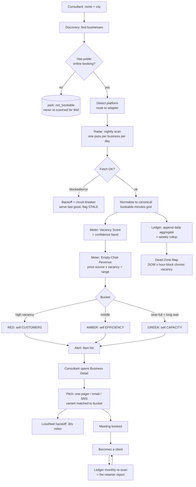
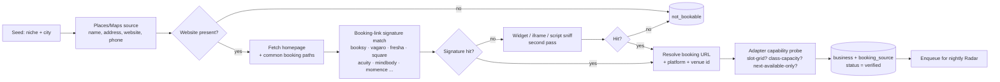
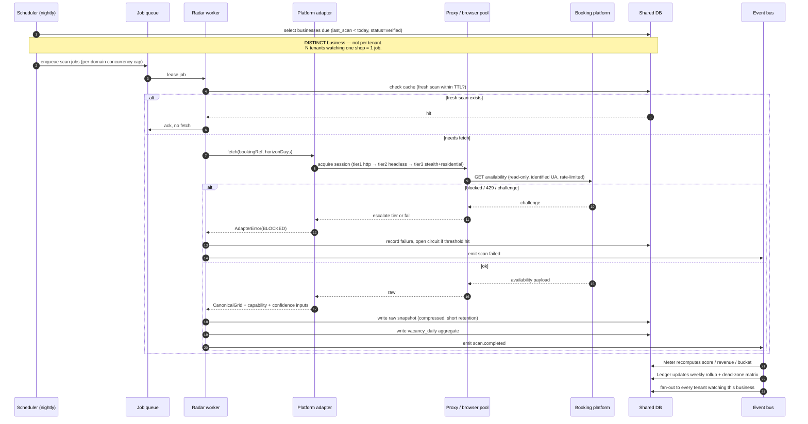
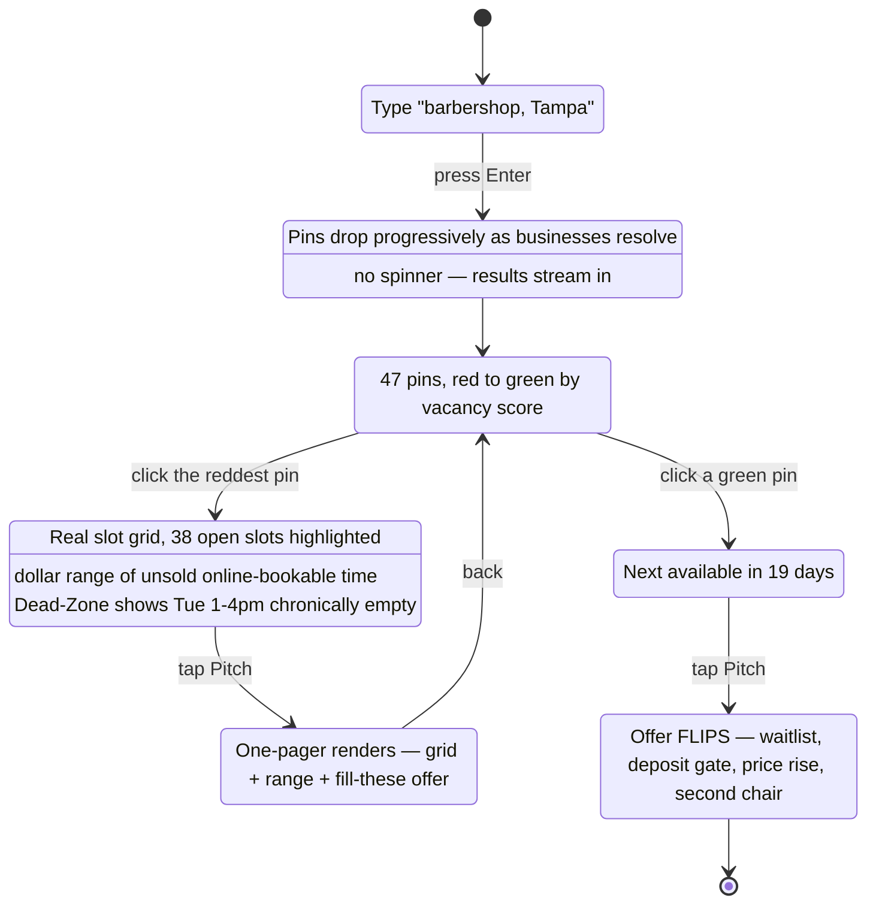
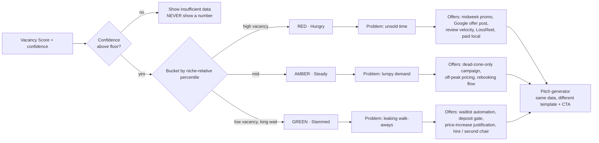
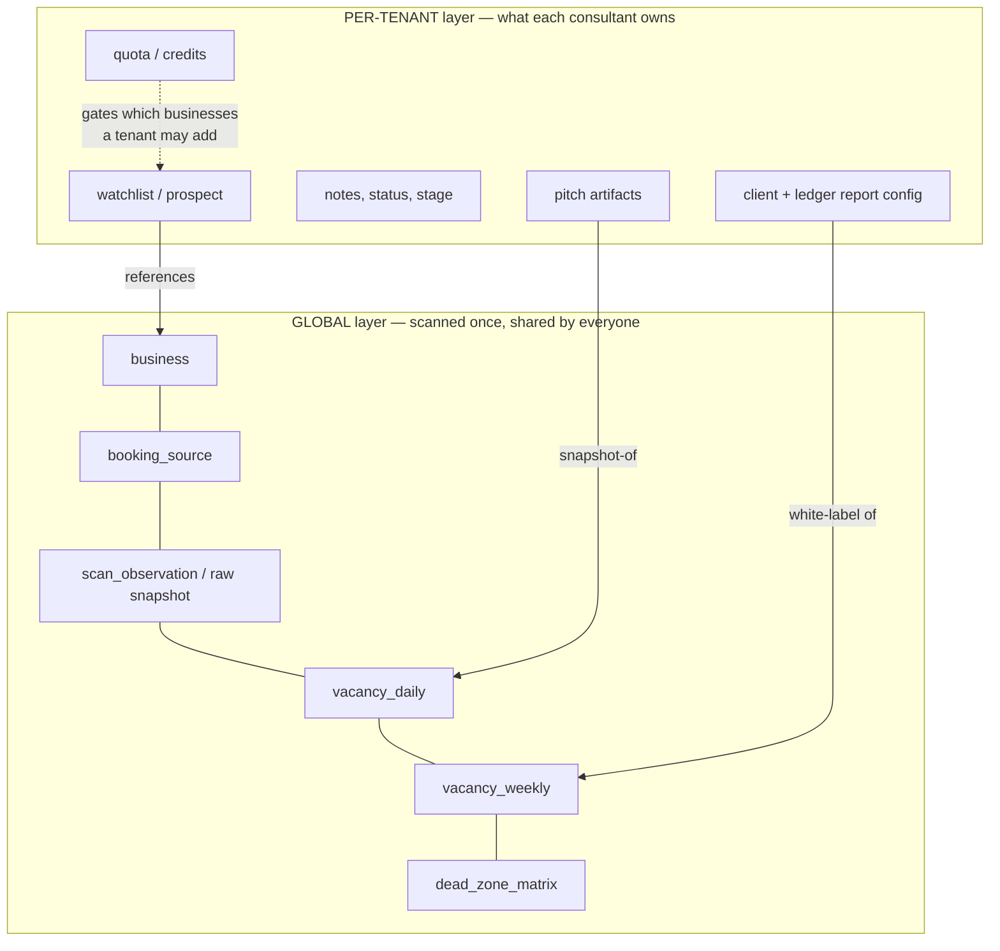
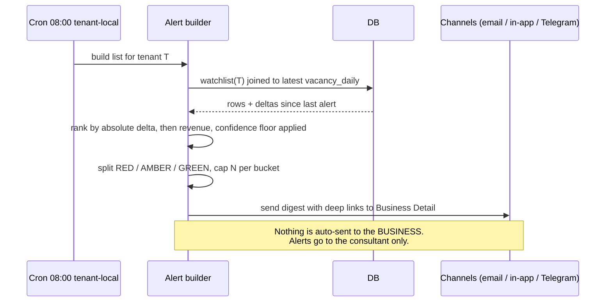
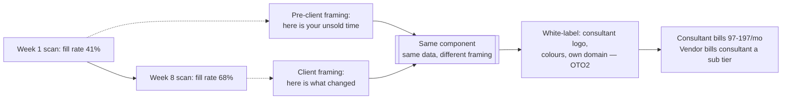
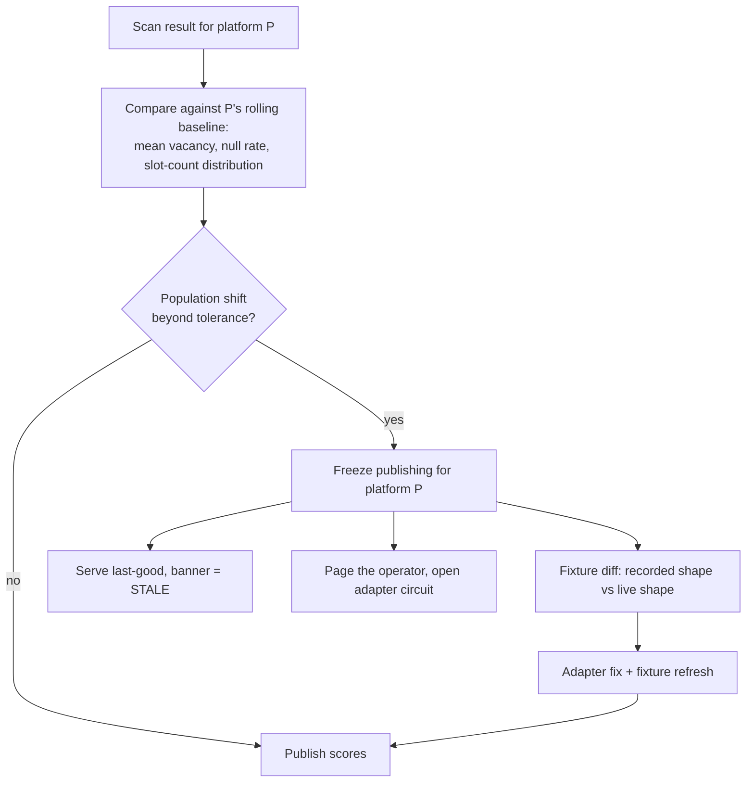
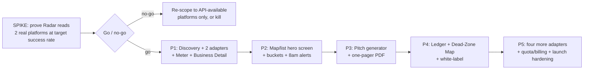

# OpenChair — Flow Diagrams

All diagrams are Mermaid. They render on GitHub, in the published blueprint artifact, and in most
markdown viewers.

Legend for lanes: **Radar** = crawler/adapters · **Meter** = scoring · **Ledger** = trend store ·
**Pitch** = artifact generator · **Discovery** = "does this business even have online booking?"

---

## 1. The master flow — S.E.A.T. end to end

**The loop that matters commercially** is `P → Q → P`: the prospecting artifact and the retainer
report are the same screen, so the thing that won the client also keeps them.

---

## 2. Discovery pipeline — getting a business into the system

You cannot scan what you have not found. Discovery is a separate, cheaper, slower pipeline that runs
ahead of Radar and is heavily cached — the booking platform a shop uses rarely changes.

Discovery results are cached **globally and shared across all tenants** — this is the primary cost
lever, and it is a schema decision, not an optimisation you bolt on later.

---

## 3. Radar scan — sequence, with the shared-scan dedupe

The single most important cost decision: two consultants watching the same Tampa barbershop trigger
**one** scan, not two.

**Read-only guarantee** lives at the adapter/proxy boundary: adapters expose no write verb, and the
HTTP layer refuses any non-GET/HEAD request to a booking host. See the architecture doc for the
code-level guard.

---

## 4. The 60-second demo flow (the thing that sells it)

Beat timing targets: search → first pins **< 4s**, full 47 pins **< 25s**, pin → detail **< 400ms**,
detail → rendered one-pager **< 3s**. If the demo cannot hit these on a webinar connection, the
launch loses its single strongest asset.

---

## 5. Two-bucket routing — one scan, two products

The AMBER bucket is a recommendation from the scoring workstream, not in the original brief. It turns
the businesses that fall between the two thresholds from "no pitch" into "the easiest pitch", because
for a lumpy-demand shop the Dead-Zone Map alone *is* the whole offer.

---

## 6. Tenancy — global scan layer vs per-tenant layer

Consequence for the business model: quota is charged on **watchlist adds and pitch generations**, not
on scans — because scans are shared. That is what protects margin when 500 launch-day buyers all pick
the same three big cities.

---

## 7. Alert — the 8am list

The product never contacts a prospect business on its own. That boundary is a compliance requirement
(TCPA/CAN-SPAM exposure sits with the consultant, and must stay there), not a missing feature.

---

## 8. Ledger — prospecting artifact becomes retainer report

---

## 9. Data-quality guardrail — the canary

The scariest failure is not a crash. It is an adapter whose selector quietly broke, returning **0 open
slots**, making every shop in a city look slammed — and the consultant walks into a meeting with a
confidently wrong number.

---

## 10. Build sequence and phase gates

The spike is the entire project risk. Everything downstream of it is ordinary product work.
